# Карты — векторные макеты

## Евразия — актуальная сборка с отдельными группами покраски

**78 деталей на одном листе 740 × 740 мм без поворотов**, четыре уровня 3 / 6 / 9 / 12 мм. Во втором слое Австрия соединена с Францией и Польшей; Венгрия соединена с Румынией и Сербией, отделена только от австрийского массива. Греция и Албания отделены от Сербии и соединены со вторым слоем Турции, Ирана и Сирии. Третий слой Турции сохранён. Туркмения отделена от Казахстана только в третьем слое; Лаос и Камбоджа объединены в третьем слое, второй слой общий с Таиландом и Китаем. Основание остаётся общим; реки и сглаживание выполнены по прежней схеме.

- [Скачать комплект](eurasia-current-cutting-740/Евразия-78-деталей-740x740.zip) · [Инструкция](eurasia-current-cutting-740/README.md)
- [Схема групп покраски](eurasia-current-cutting-740/Группы-покраски.pdf) · [Blender](eurasia-current-cutting-740/Евразия-производственная-сборка.blend)
- [Рабочий SVG: версия 78](eurasia-current-cutting-740/Евразия-78-деталей-740x740.svg) · [Европа крупно](eurasia-current-cutting-740/Европа-крупно-3D.png)

---

## Россия — актуальная сборка, три слоя для резки

**33 детали вместо 231 исходного объекта: 9 + 12 + 12.** По обновлённому пользовательскому файлу сохранены уровни 3 / 6 / 9 мм. Части объединены по высоте, мелкие зубцы сглажены; реки, Байкал и Таймыр выполнены с узкой нижней прорезью. Один комплект на листе 740 × 740 мм без поворотов.

- [Скачать комплект](russia-current-cutting-740/Россия-актуальная-раскрой-740x740.zip) · [Инструкция](russia-current-cutting-740/README.md)
- [SVG с редактируемыми надписями](russia-current-cutting-740/Поле-01-740x740.svg) · [Blender](russia-current-cutting-740/Россия-производственная-сборка.blend)
- [Посмотреть сборку](russia-current-cutting-740/Россия-сборка-3D.png) · [Раскладка](russia-current-cutting-740/Схема-раскладки-с-номерами.pdf)

---

## Евразия — объединённые слои для резки 740 × 740 мм

**75 деталей вместо 234, один комплект на одном листе без поворотов.** Сохранены пять фактических уровней присланной сборки: 3 / 6 / 9 / 12 / 15 мм. Мелкие зубцы сглажены, общие стыки объединены. В основании добавлены узкие прорези 21 речной системы; существующие верхние вырезы сохранены, целые верхние участки остаются целыми.

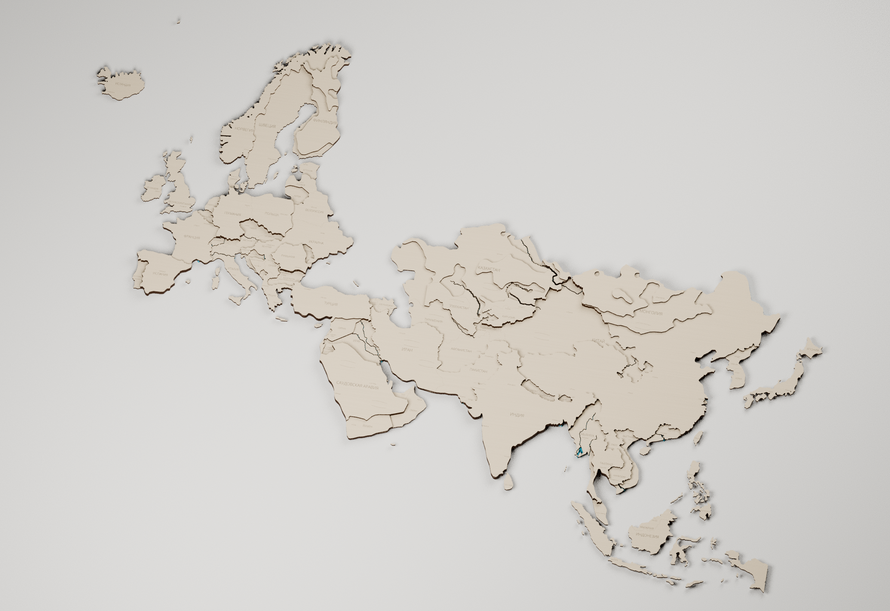

- [Скачать готовый комплект](eurasia-cutting-740/Евразия-раскрой-740x740.zip) · [Инструкция](eurasia-cutting-740/README.md)
- [Рабочий SVG с редактируемыми надписями](eurasia-cutting-740/Поле-01-740x740.svg) · [PDF 1:1](eurasia-cutting-740/Поле-01-740x740.pdf)
- [Сборка Blender](eurasia-cutting-740/Евразия-производственная-сборка.blend) · [Схемы пяти слоёв](eurasia-cutting-740/Слои-и-сборка.pdf)
- [Европа крупно](eurasia-cutting-740/Европа-крупно-3D.png) · [Азия и реки](eurasia-cutting-740/Азия-реки-3D.png)

Чёрный — сквозная резка, красный — города и видимые внутренние линии, синий — страны. Все 156 надписей сохранены текстом. Геометрия SVG/PDF и 75 замкнутых тел Blender проверены; центры деталей находятся снизу.

---

## Южная Америка / Бразилия — крупные монолитные террасы

**78 деталей вместо 146.** Мелкие соседние возвышенности объединены в связные массивы; Анды, крупные плато и речные понижения сохранены. Прежние политические части и окраска остаются. Титикака, Уюни, Анхель, Игуасу и Мачу-Пикчу проверены в Blender; начала отсчёта снизу и зависимые высоты сохранены.

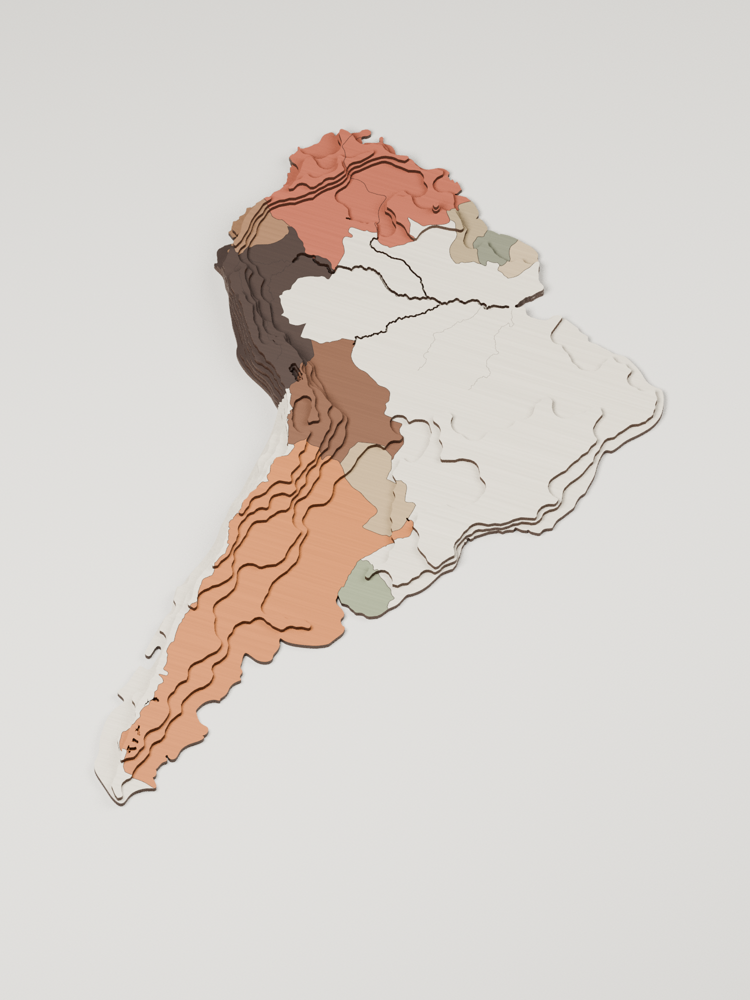

- [Скачать Blender и SVG](south-america-relief-monolithic/Южная-Америка-монолитная-комплект.zip) · [Инструкция](south-america-relief-monolithic/README.md)
- [Сравнить до и после](south-america-relief-monolithic/Сравнение-укрупнения.png) · [Анды крупно](south-america-relief-monolithic/Анды-Титикака-Уюни-3D.png)

---

## Россия и Африка — взаимозаменяемые политические модули

Финальная Россия разделена на 84 региональных модуля, монолитная Африка — на 52 модуля стран и территорий. Сохранены природные ступени, водные вырезы и пирамида Египта. В каждом комплекте рельефная, плоская и плоская водная версии Blender с общими центрами снизу, SVG и проверенный скрипт замены частей.

- [Россия: скачать комплект](russia-relief-politics/Россия-политика-и-рельеф.zip) · [Инструкция](russia-relief-politics/README.md)
- [Африка: скачать комплект](africa-relief-politics/Африка-политика-и-рельеф.zip) · [Инструкция](africa-relief-politics/README.md)

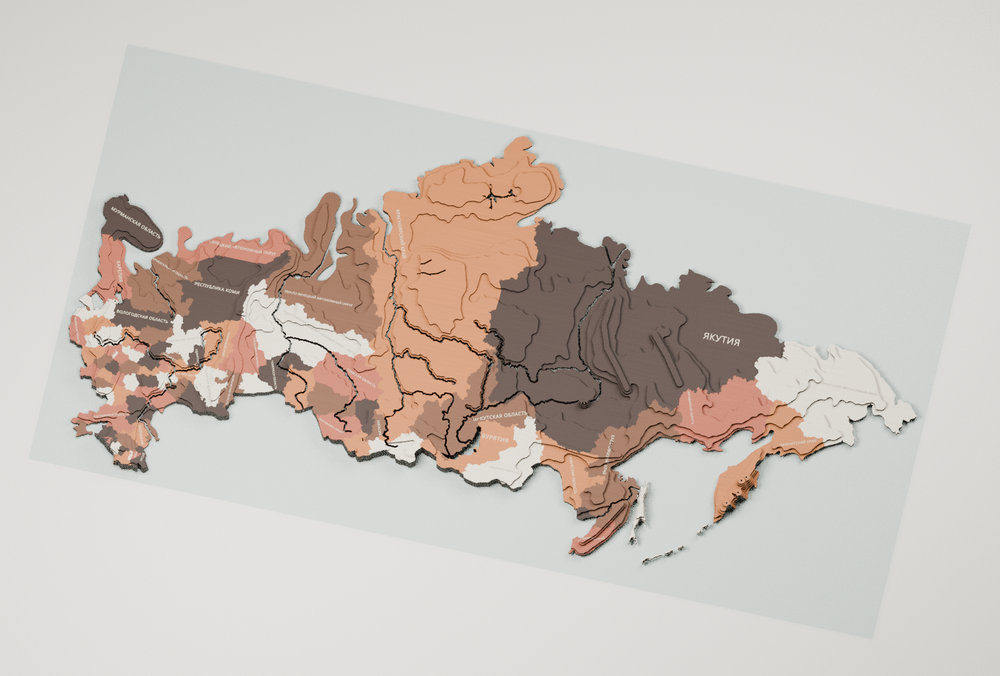

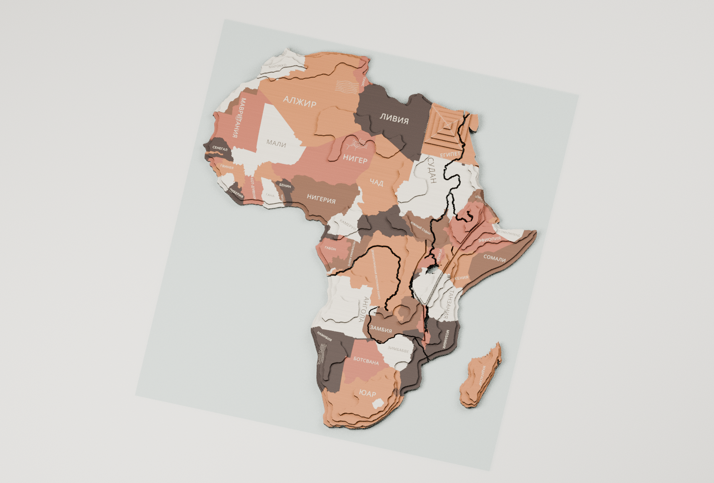

---

## Евразия — рельеф и плоские политические части

**120 совместимых модулей** Европы и оставшейся Азии, включая отдельные провинции Китая. Рельеф: 824 новые детали, шесть уровней 3 / 6 / 9 / 12 / 15 / 18 мм. Плоский политический вариант: 226 отдельных тел. Координаты и нижние центры совпадают — страны и провинции можно заменять между вариантами встроенным скриптом Blender.

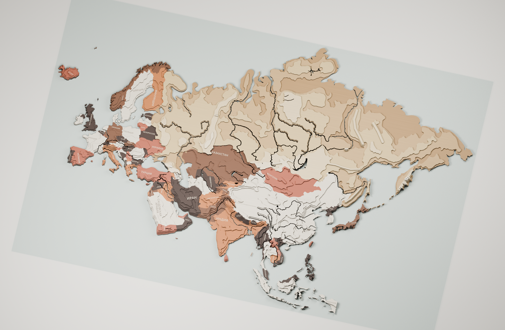

- [Скачать Blender, SVG и маски окраски](eurasia-relief-politics/Евразия-комплект.zip)
- [Генератор и геоданные](eurasia-relief-politics/Евразия-генератор.zip)
- [Рельеф по политическим частям](eurasia-relief-politics/Евразия-рельеф-по-регионам.blend) · [Плоская политическая](eurasia-relief-politics/Евразия-политическая.blend)
- [Политический вариант — превью](eurasia-relief-politics/Евразия-политическая-3D.png) · [Дополнительный плоский вариант со сквозной водой](eurasia-relief-politics/Евразия-политическая-с-водой.blend)
- [Европа и Альпы](eurasia-relief-politics/Европа-Альпы-3D.png) · [Гималаи и Тибет](eurasia-relief-politics/Гималаи-Тибет-3D.png) · [Тянь-Шань и Памир](eurasia-relief-politics/Тянь-Шань-Памир-3D.png)
- [Аравия и Иран](eurasia-relief-politics/Аравия-Иран-3D.png) · [Япония и Фудзи](eurasia-relief-politics/Япония-Фудзи-3D.png) · [Индонезия](eurasia-relief-politics/Индонезия-3D.png)
- [Инструкция по сборке и замене модулей](eurasia-relief-politics/ПРОЧИТАТЬ.md) · [Детали и слои](eurasia-relief-politics/Детали-для-сборки.csv)

Одна страна — одно покрытие: натуральная фанера, тик, орех, тёмный акцент или терракота. Все её провинции и острова окрашены одинаково, соседние страны различаются. Реки и озёра сквозные, кратеры и сухие вади сохраняют дно. Страновые надписи в замкнутых кривых следуют высоте деталей. Готовые Россия и Африка сохранены без изменений; Россия включена в общий рельефный обзор как справочная сборка.

---

## Россия — единый ступенчатый ландшафт

**67 деталей, шесть уровней: 3 / 6 / 9 / 12 / 15 / 18 мм.** Запад и центр переработаны в общий ландшафт: широкие основания равнин, переходы к Уралу и центральным плато, речные понижения. Путорана связана со Среднесибирским плоскогорьем; Таймыр и Бырранга получили выраженный северный массив. Отдельные вытянутые западные накладки удалены. Сохранены горные и вулканические акценты востока.

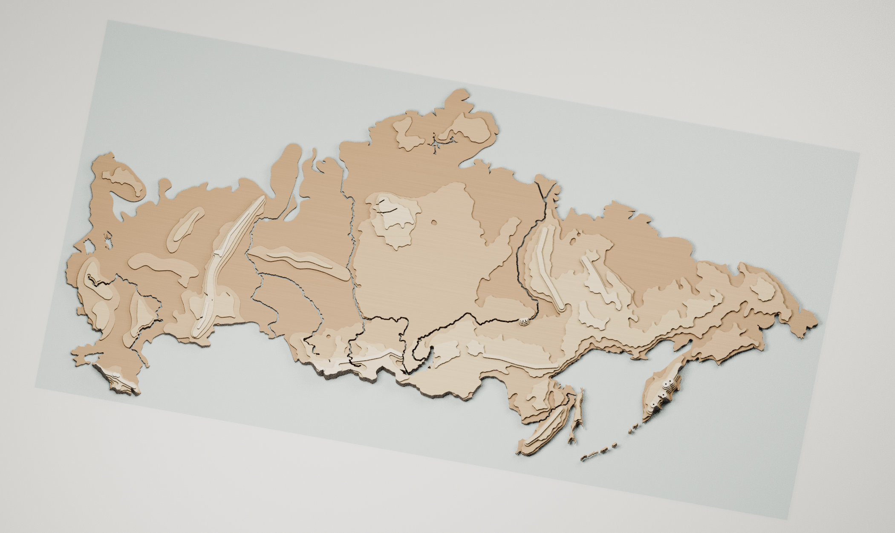

- [Скачать Blender и векторы всех слоёв](russia-relief/Россия-рельеф-комплект.zip)
- [Европейская часть](russia-relief/Европейская-Россия-3D.png) · [Урал и Екатеринбург](russia-relief/Урал-Екатеринбург-3D.png)
- [Центральная Сибирь](russia-relief/Центр-Сибирь-3D.png) · [Таймыр и Бырранга](russia-relief/Таймыр-Бырранга-3D.png)
- [Предыдущая композиция для сравнения](russia-relief/Россия-предыдущая-композиция.png)
- [Готовая сцена Blender](russia-relief/Россия-рельеф.blend) · [Общий вектор](russia-relief/Россия-рельеф.svg) · [Вид сверху](russia-relief/Россия-рельеф.png)
- [Байкал](russia-relief/Байкал-3D.png) · [Камчатка](russia-relief/Камчатка-вулканы-3D.png) · [Кавказ и Эльбрус](russia-relief/Кавказ-Эльбрус-3D.png) · [Путорана](russia-relief/Путорана-3D.png)
- [Состав деталей](russia-relief/Состав-слоёв.csv) · [Схема объектов](russia-relief/Схема-природных-объектов.png) · [Инструкция](russia-relief/ПРОЧИТАТЬ.md)

Реки и озёра проходят насквозь до оргстекла. Речная схема дополнена реальными руслами Камы, Северной Двины, двух Тунгусок и Вилюя с широкими ступенчатыми берегами. Кратеры и гейзерная долина сохраняют деревянное дно. Вторая ступень занимает около 78,6% основания вместо 52%; третья — 44,7% вместо 19,2%. Мелкие случайные понижения заполнены; число деталей снижено с 73 до 67.

Материк — из пользовательского CDR, высотная основа — ETOPO10/ETOPO1, водные линии — Natural Earth. Масштабы низких возвышенностей художественно усилены ради композиции. Mesh, зависимые высоты, сквозная вода, соединения рек и донья кратеров проверены; фактический масштаб, материал и пропил задаются перед производством.

---

## Африка — укрупнённый вариант для более простой сборки

Отдельная альтернатива: **34 детали фанеры вместо 103**. Третий слой уменьшен с 35 до 10 частей, четвёртый — с 46 до 11. Соседние возвышенности объединены в крупные террасы, случайные мелкие накладки убраны. Пирамида Египта, Килиманджаро и сквозные реки и озёра сохранены.

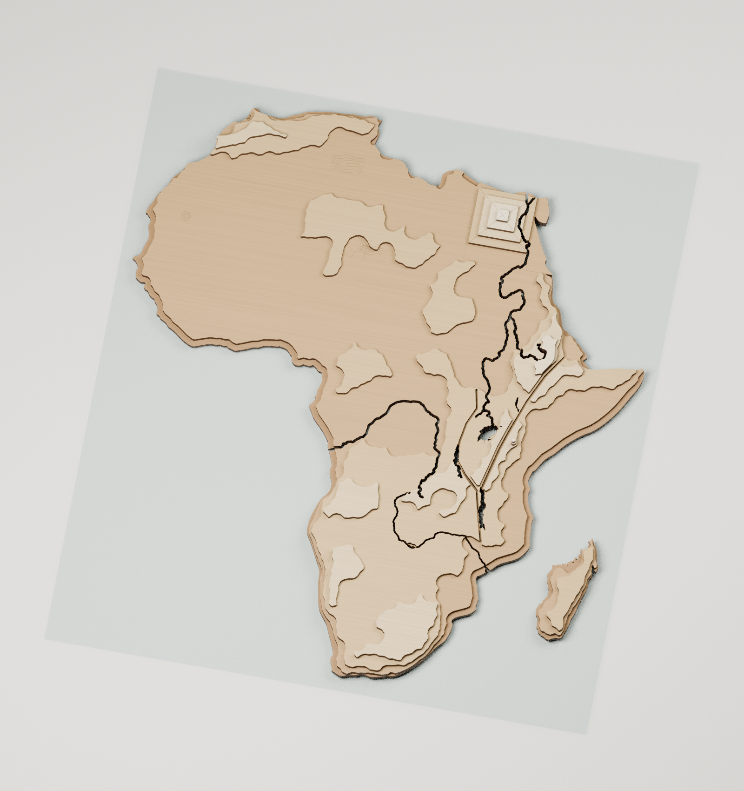

- [Скачать Blender и SVG укрупнённого варианта](africa-relief-monolithic/Африка-укрупнённая-комплект.zip)
- [Сравнить подробный и укрупнённый рельеф](africa-relief-monolithic/Сравнение-детальности.png)
- [Крупные террасы — объёмный фрагмент](africa-relief-monolithic/Монолитные-террасы-3D.png)
- [Готовая сцена Blender](africa-relief-monolithic/Африка-монолитная.blend) · [Общий вектор](africa-relief-monolithic/Африка-монолитная.svg)
- [Количество деталей по слоям](africa-relief-monolithic/Сравнение-количества-деталей.csv) · [Инструкция](africa-relief-monolithic/ПРОЧИТАТЬ.md)

Сохранены шесть высот и исходные координаты. Суммарная длина контуров резки уменьшена примерно на 14%; геометрия художественно укрупнена ради производства. Подробный вариант ниже остаётся отдельным комплектом.

---

## Африка — рельеф со сквозными реками и озёрами

Шесть уровней фанеры с главными акцентами: **Нил с дельтой, Конго, Виктория, Танганьика, Малави, Замбези и водопад Виктория, Великий рифт, Эфиопское нагорье, Атлас и Килиманджаро**. Сахара дополнена спокойной фактурой дюн и трещин; Ришат — гравированными кольцами. Мадагаскар подготовлен отдельной опцией с центральным нагорьем. **Египет обозначен большой ступенчатой пирамидой внутри его политической границы; Нил и дельта остаются сквозными.**

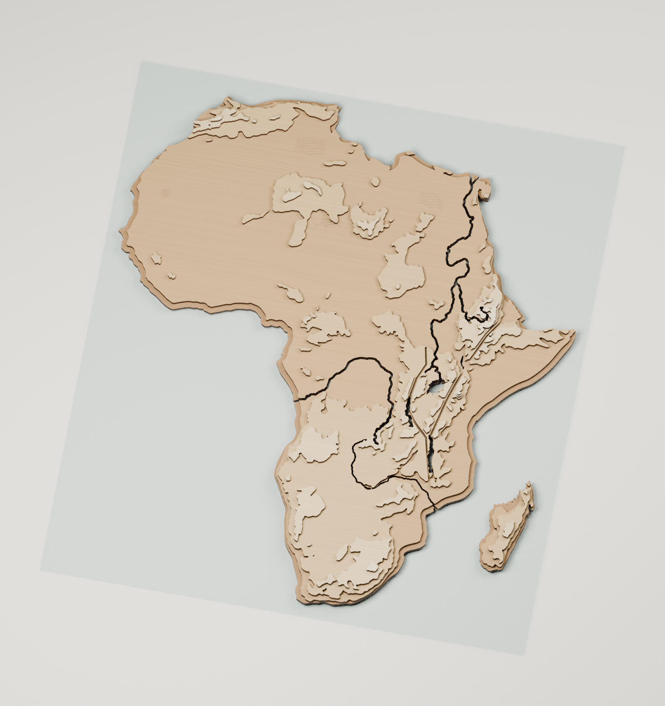

- [Скачать Blender + SVG слоёв и нанесения](africa-relief/Африка-комплект.zip)
- [Готовая сцена Blender](africa-relief/Африка-рельеф.blend)
- [Основание со сквозными вырезами](africa-relief/Основание-сквозные-вырезы.png) · [Вид сверху](africa-relief/Африка-рельеф-цветной.png) · [Вектор](africa-relief/Африка-рельеф-цветной.svg)
- [Египет — пирамида крупно](africa-relief/Египет-пирамида-3D.png) · [Вектор Египта](africa-relief/Египет-пирамида.svg)
- [Озёра и рифт крупно](africa-relief/Озёра-и-рифт-3D.png) · [Уступ водопада Виктория](africa-relief/Замбези-Виктория-3D.png)
- [Схема природных объектов](africa-relief/Схема-природных-объектов.png) · [Расшифровка номеров](africa-relief/Природные-объекты.csv)
- [Сборка, источники и обобщения](africa-relief/ПРОЧИТАТЬ.md)

Основной силуэт — из пользовательского CDR, высотная основа — ETOPO10 / ETOPO1 с декоративной адаптацией. Высоты **3 / 6 / 9 / 12 / 15 / 18 мм**. Реки и озёра — сквозные вырезы во всех слоях под оргстекло, фактура — отдельная гравировка; из политических границ выделен только Египет, исходные подписи в оформление не входят.

---

## Южная Америка — реальный рельеф и окраска стран

Шесть вложенных уровней фанеры, **3 / 6 / 9 / 12 / 15 / 18 мм**, на основе цифровых высот ETOPO. Контур и политические границы взяты из пользовательского CDR. Анды высокие, Амазония низкая с речными вырезами; Титикака — котловина, Уюни — ровное плато. Малые объекты обобщены под масштаб.

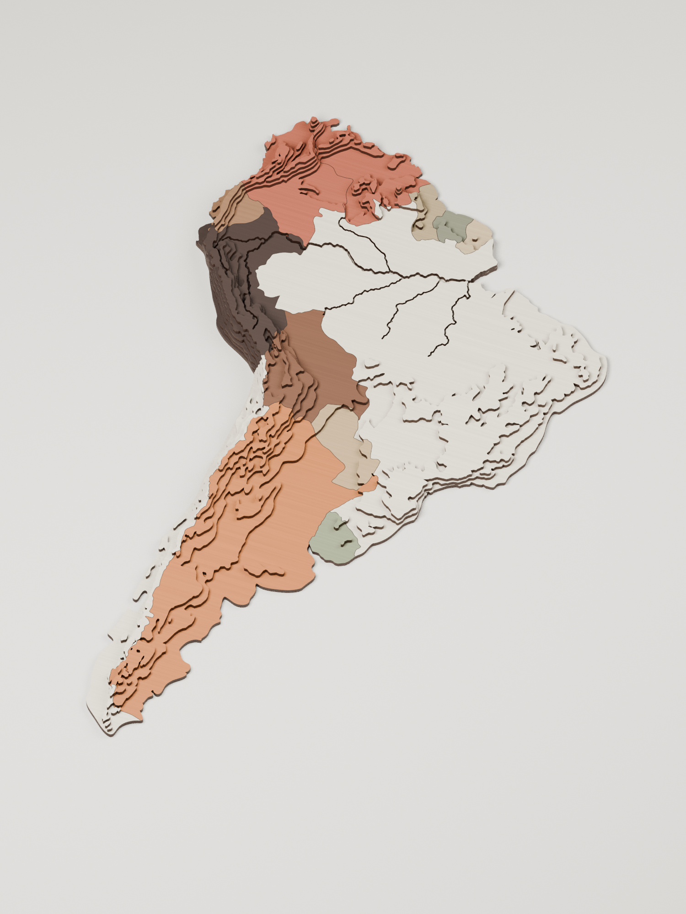

- [Скачать Blender + SVG + маски окраски](south-america-relief/Южная-Америка-комплект.zip)
- [Открыть Blender-файл](south-america-relief/Южная-Америка-рельеф.blend)
- [Цветной вид сверху](south-america-relief/Карта-цвета-и-границы.png) · [Анды, Титикака и Уюни крупно](south-america-relief/Анды-Титикака-Уюни-3D.png)
- [Вектор с окраской и границами](south-america-relief/Карта-цвета-и-границы.svg) · [Схема шести уровней](south-america-relief/Рельеф-шесть-уровней.png)
- [Инструкция, источники и обобщения](south-america-relief/ПРОЧИТАТЬ.md) · [Палитра](south-america-relief/Палитра.csv)

Бразилия и Чили — светлая фанера; Аргентина — рыжая, Боливия — орех, Перу — тёмный акцент, Колумбия и Венесуэла — терракота. Границы вынесены в гравировку, окраска — в маски стран; контуры резки следуют природному рельефу. Генератор и вырезка реальной DEM приложены в папке комплекта.

---

## Природный рельеф по прежним политическим областям

Тот же рельеф дополнительно разрезан на **65 модулей по прежним областям**. В каждом модуле — собственные детали трёх уровней, гравировка и городские подсказки. Положение и масштаб совпадают с предыдущей политической версией: области можно заменять и комбинировать.

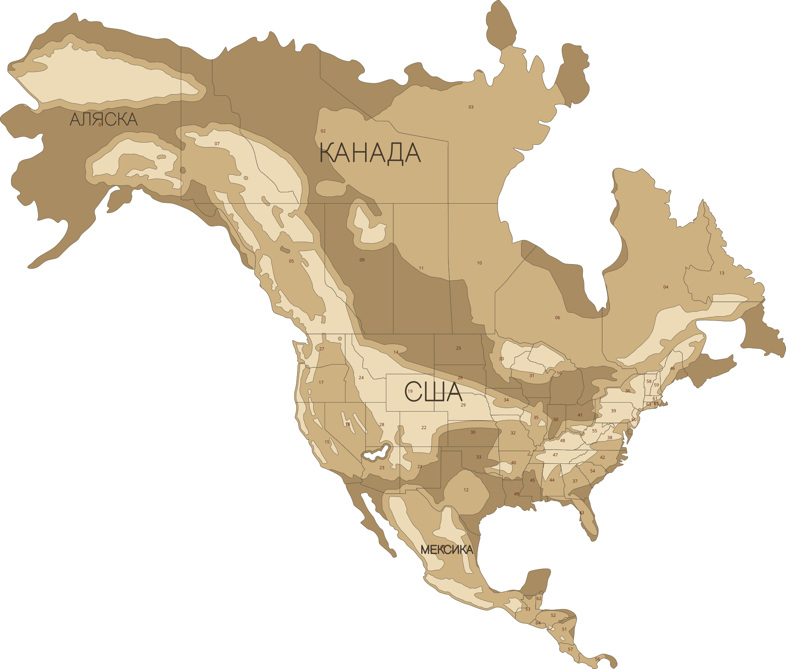

- [Скачать комплект Blender + SVG](canada-natural-relief-regions/Рельеф-по-регионам-комплект.zip)
- [Blender: 65 отдельных модулей](canada-natural-relief-regions/Рельеф-по-политическим-областям.blend)
- [Пример одной области](canada-natural-relief-regions/Пример-отдельной-области.png) · [Общий объёмный вид](canada-natural-relief-regions/Рельеф-по-регионам-3D.png)
- [SVG по отдельным областям](canada-natural-relief-regions/SVG-по-регионам) · [Состав деталей](canada-natural-relief-regions/Состав-регионов.csv)
- [Как переносить и сочетать области](canada-natural-relief-regions/ПРОЧИТАТЬ.md)

---

## Природный рельеф Северной Америки — три слоя

Новый вариант по природным районам: горные цепи, плато и низменности вместо политического деления. Основные отметки **3 / 6 / 9 мм**, отдельные опции — нижняя подкладка каньона и верхняя вершина Денали до 12 мм.

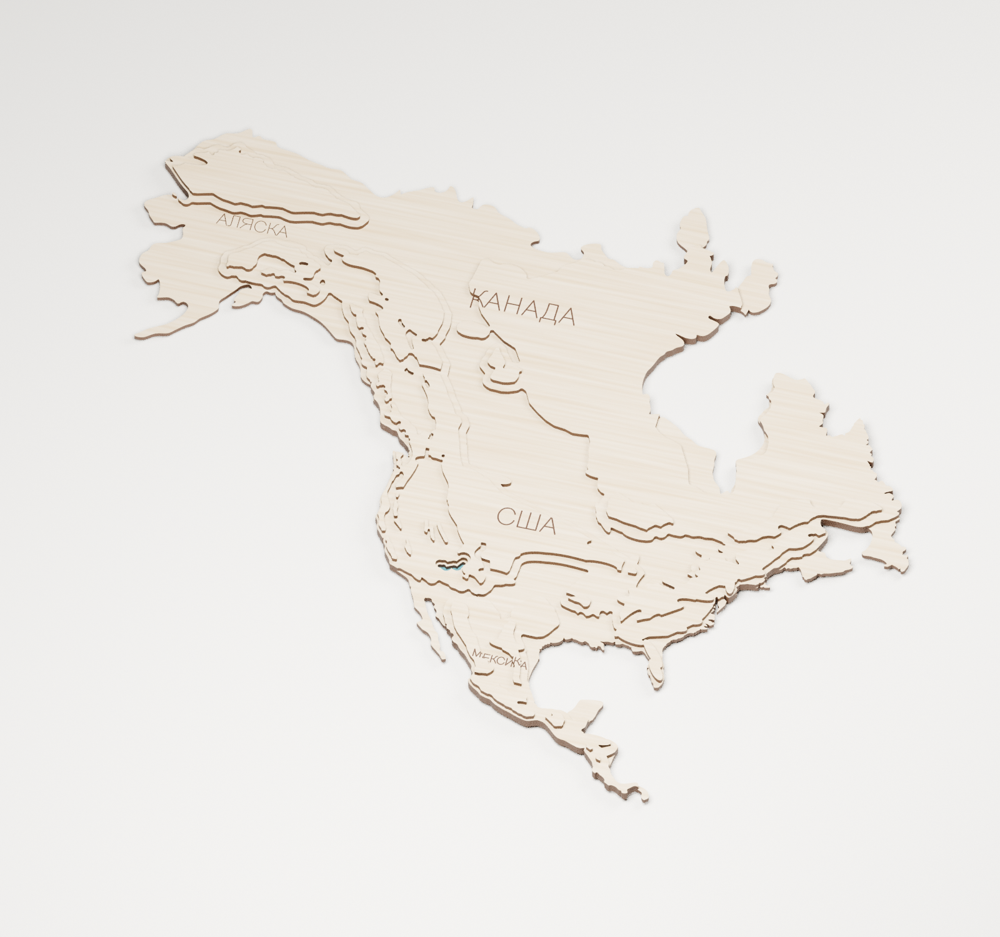

- [Скачать Blender + SVG + гравировку](canada-natural-relief/Природный-рельеф-комплект.zip)
- [Готовая сцена Blender](canada-natural-relief/Природный-рельеф.blend)
- [Вид сверху](canada-natural-relief/Рельеф-вид-сверху.png) · [Гранд-Каньон крупно](canada-natural-relief/Гранд-Каньон-3D.png)
- [Общий вектор](canada-natural-relief/Рельеф-три-слоя.svg) · отдельные [слой 1](canada-natural-relief/Слой-01.svg), [слой 2](canada-natural-relief/Слой-02.svg), [слой 3](canada-natural-relief/Слой-03.svg)
- [80 ровных мест под города](canada-natural-relief/Города-площадки-проверка.png)
- [Сборка, гравировка и дополнительные опции](canada-natural-relief/ПРОЧИТАТЬ.md)

Крупные названия стран разделены по поверхностям разных высот; городские подписи остаются на ровных площадках. Контуры художественно обобщены под три слоя по географическим формам Natural Earth; это не равномерные изогипсы DEM.

---

## Северная Америка — подготовка для Blender

**Обновлённая сцена:** регионы растут вверх от нижней плоскости при вводе высоты Z. Надписи и значки автоматически остаются над верхом своих территорий. По умолчанию регионы имеют высоту 3 мм; проверены значения 3/6/9 мм.

Из файла «для гпт канада.cdr»: **65 отдельных замкнутых регионов**, 86 надписей и 72 значка городов с замкнутыми контурами. Сохранены координаты рисунка, общие границы соседних деталей совпадают. Все регионы проверены импортом и пробным выдавливанием в Blender 4.3.2.

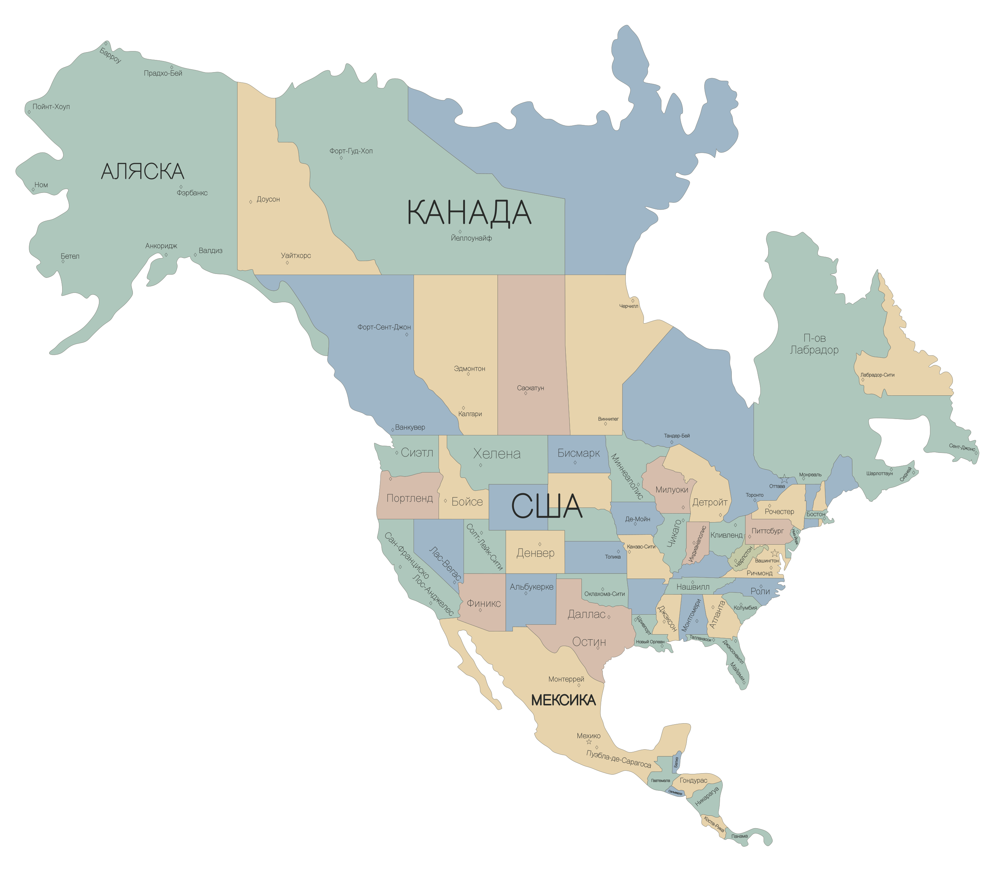

- [Скачать весь комплект](canada-blender/Канада-Blender-комплект.zip)
- [Обновлённый Blender-файл: рост от нижней плоскости](canada-blender/Канада-рельеф-от-низа.blend)
- [Общий рабочий SVG](canada-blender/Канада-Blender-всё.svg)
- Отдельно: [регионы](canada-blender/01-Регионы.svg), [надписи](canada-blender/02-Надписи.svg), [значки городов](canada-blender/03-Города.svg), [общий силуэт](canada-blender/04-Общий-контур.svg)
- [Список регионов](canada-blender/Список-регионов.csv) · [Подробности и исправленные разрывы](canada-blender/ПРОЧИТАТЬ.md)

Под надписью «США» и возле Оттавы восстановлены прерванные продолжения границ. Измеренное отклонение при последующей оптимизации замкнутых контуров — менее 0,01 мм.

---

## Компас «Меридиан»

Векторная роза ветров для гравировки: 16 лучей, контрастные грани, тонкое кольцо делений и северный указатель. Две версии — с русскими и международными обозначениями. Все линии и буквы превращены в замкнутые чёрные заливки.

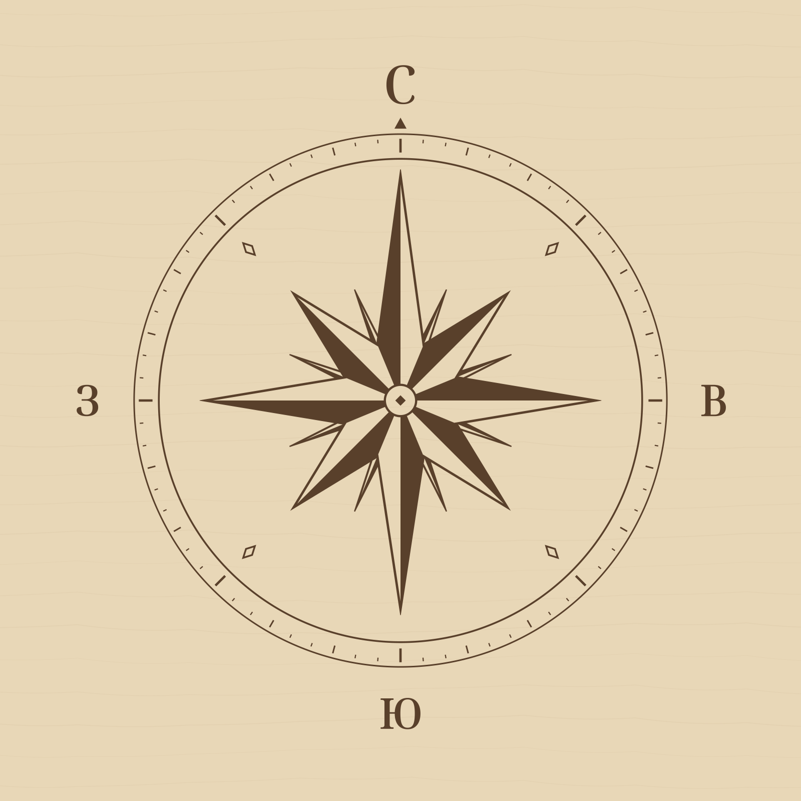

- [Вектор с С/В/Ю/З — SVG](compass-meridian/Компас-Меридиан-ru.svg)
- [Вектор с N/E/S/W — SVG](compass-meridian/Компас-Меридиан-en.svg)
- [Скачать комплект SVG/PDF/PNG](compass-meridian/Компас-Меридиан-комплект.zip)
- [Описание файлов](compass-meridian/ПРОЧИТАТЬ.md)

---

## АСТРА — три раскраски

Пастельный бежевый с молочным белым, дымчатый серый с графитом и «Голубая лагуна» с мятой и петрольным. В каждом варианте натуральная фанера + два покрытия в двух интенсивностях. Одна страна — один цвет, независимо от высоты рельефа.

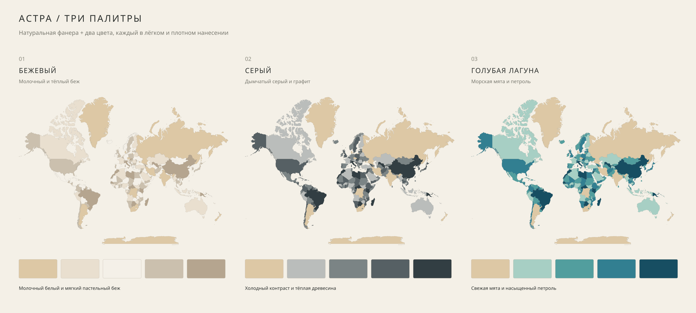

- [Скачать комплект раскрасок ZIP](astra-colors/АСТРА-три-раскраски.zip)
- [Презентация — PDF](astra-colors/АСТРА-три-раскраски.pdf)
- Векторные страны: [бежевый](astra-colors/01-Бежевый-страны.svg), [серый](astra-colors/02-Серый-страны.svg), [голубая лагуна](astra-colors/03-Голубая-лагуна-страны.svg)
- [Таблица покрытий по странам](astra-colors/Страны-и-цвета.csv) · [Описание](astra-colors/ПРОЧИТАТЬ.md)

---

## АСТРА — три уровня рельефа

Новая схема декоративного рельефа по странам и административным регионам. Три высоты: основа, связанные плато и верхние акценты. Толщина материала и производственные размеры не заданы.

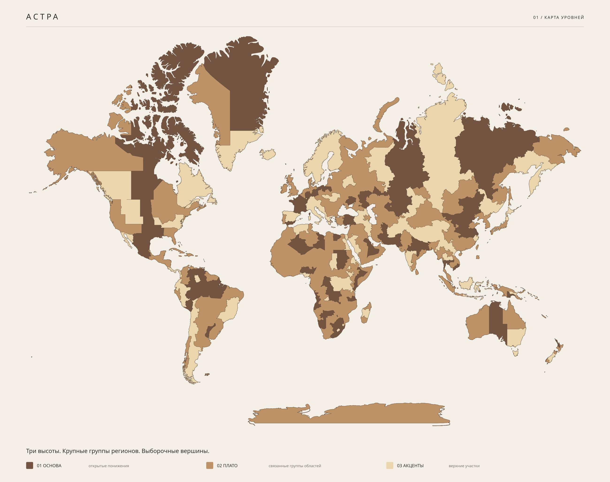

- [Скачать весь комплект ZIP](astra-relief/АСТРА-комплект.zip)
- [Презентация с крупными фрагментами — PDF](astra-relief/АСТРА-презентация.pdf)
- [Основной вектор с тремя слоями — SVG](astra-relief/АСТРА-три-слоя.svg)
- Отдельные контуры: [слой 1](astra-relief/Слой-01.svg), [слой 2](astra-relief/Слой-02.svg), [слой 3](astra-relief/Слой-03.svg)
- [Описание композиции и форматов](astra-relief/ПРОЧИТАТЬ.md)

Это схема распределения высот в географии «АСТРЫ». Точная посадка на упрощённый контур прежнего макета подложки пока не выполнена.

---

## Подложка карты — дизайн 03

Новый цельный векторный макет: океаны набраны Noto Serif Display, моря и заливы — Noto Sans. В композиции 85 подписей. Буквы переведены в кривые; растровых изображений в рабочих SVG и PDF нет.

- [Общий вид](дизайн-03/Атлас-03-общий-вид.png)
- [Презентация с крупными фрагментами — PDF](дизайн-03/Атлас-03-презентация.pdf)
- [Полный векторный макет — SVG](дизайн-03/Атлас-03-макет.svg)
- [Только надписи в кривых — SVG](дизайн-03/Атлас-03-надписи-в-кривых.svg)
- [Инструкции и ограничения](дизайн-03/ПРОЧИТАТЬ.md)

Голубой и серый обозначают справочные зоны оргстекла и карты. Для надписей предоставлен отдельный файл без этих заливок. Дизайн подготовлен для согласования и технологической пробы; посадку перед тиражом следует проверить по фактической карте.

Предыдущие варианты сохранены в папках `макет` и `океаны-вариант-2` как история работы.
