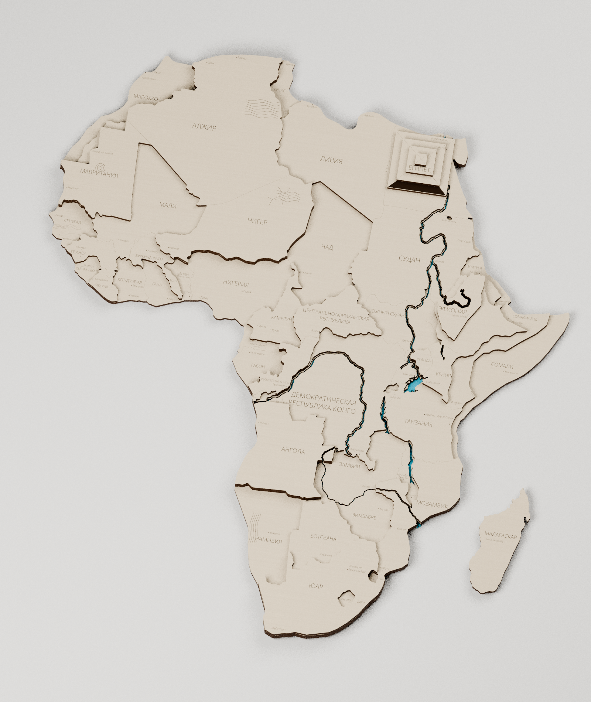
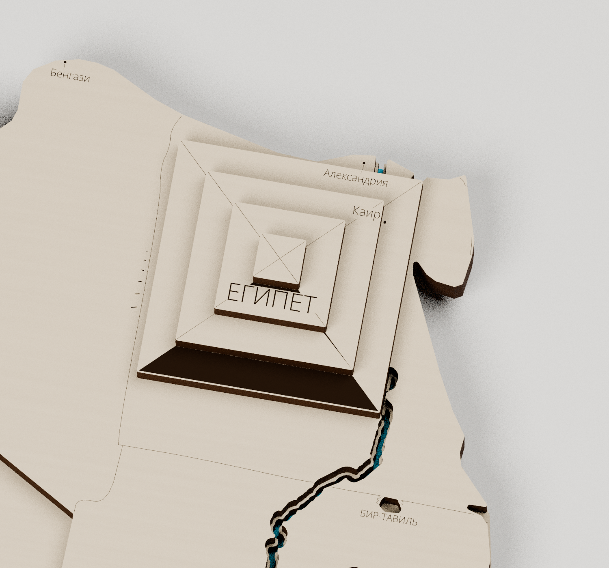
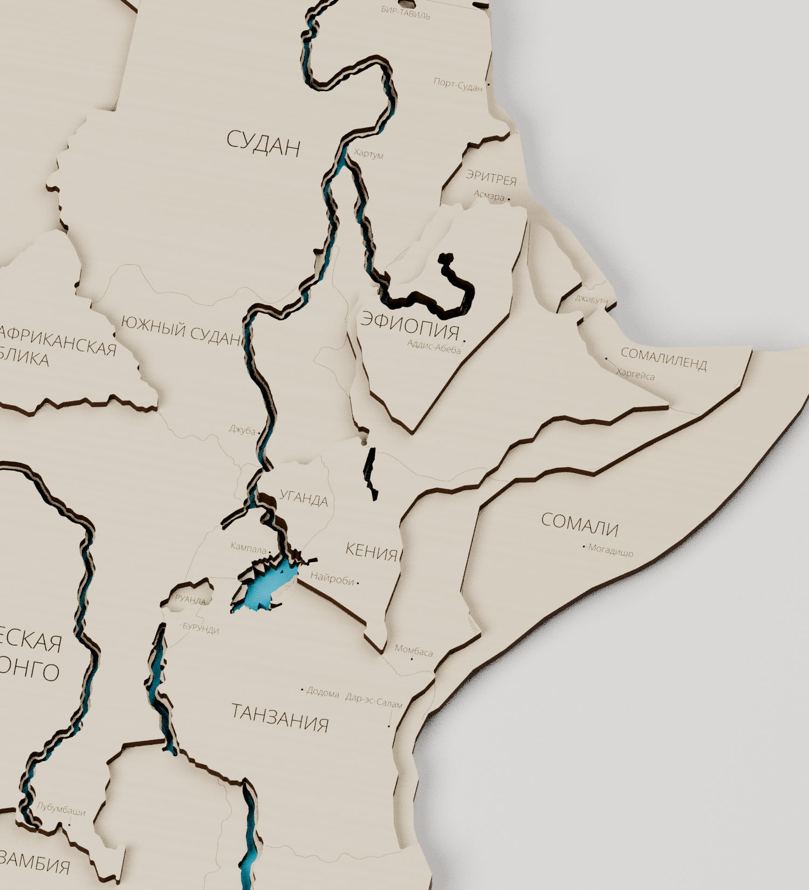
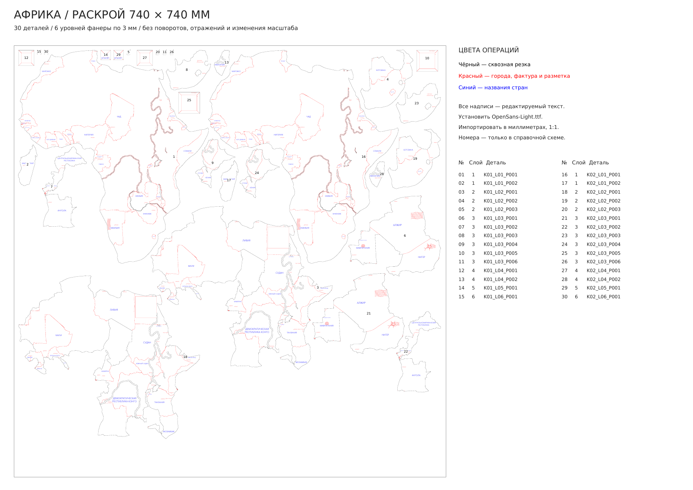

# Африка — монолитные слои и раскрой 740 × 740 мм

[Скачать комплект](Африка-раскрой-740x740.zip) · [Две карты на листе — SVG](Два-комплекта/Поле-01-740x740.svg) · [Две карты — PDF 1:1](Два-комплекта/Поле-01-740x740.pdf) · [Одна карта — SVG](Поле-01-740x740.svg) · [Blender](Африка-производственная-сборка.blend)

**На одном листе 740 × 740 мм помещаются два полных комплекта — 30 деталей.** Один комплект состоит из **15 деталей: 2 + 3 + 6 + 2 + 1 + 1** по шести слоям фанеры 3 мм. Все детали только перенесены: без поворотов, отражений и изменения масштаба. В корне сохранена раскладка на одну карту, в `Два-комплекта/` — на две.

## Контуры и слои

Использована фактическая геометрия присланного файла «Африка-политическая.blend». Сохранены габарит, положение Мадагаскара и выбранные высоты: **3 / 6 / 9 / 12 / 15 / 18 мм**. Исходные 143 деревянных объекта объединены по высоте в крупные физические детали. Политические границы не разделяют общий кусок фанеры. **Красить можно по слоям, цвет каждого слоя выбираете сами.**

Первый слой — цельный материк и отдельный Мадагаскар. На следующих слоях соединены соприкасающиеся участки одинаковой высоты; отдельные острова не соединялись искусственными перемычками. Убраны паразитные микрофрагменты и микроскопические щели исходных стыков.

Мелкие зубцы сглажены с сохранением крупных очертаний. Упрощение 0,24 мм, закрытие узких щелей радиусом 0,44 мм, скругление мелких выступов радиусом 0,30 мм. Общие линии границ сглажены согласованно. В сумме по контурам деревянных слоёв: **47,721 → 14,992 точек**, сокращение примерно **69%**. Берега озёр дополнительно приглажены; их длинные характерные формы сохранены.

[Векторное сравнение до и после](Сравнение-до-и-после.pdf) · [Схемы шести слоёв](Слои-и-сборка.pdf)

## Пирамида и полоса у Кении/Эфиопии

**Пирамида Египта цельная.** Под её квадратным основанием Нил закрыт во всех слоях. Четыре квадратные ступени, включая вершину, не имеют речных прорезей и состоят каждая из одной детали. Снаружи этого основания русло продолжается; дельта сохранена. Диагонали граней — красная гравировка, а не разрезы фанеры.

Длинная ровная рифтовая полоса, разрезавшая соседние массивы в Кении и Эфиопии, закрыта. Озёра Туркана, Виктория, Танганьика и Малави сохранены. Остальные выбранные пользователем перепады высоты оставлены.

## Вода ступенькой

В первом слое вырезы рек примерно вдвое уже верхних: **Нил 0,825 / 1,65 мм**, **Конго 0,85 / 1,7 мм**, **Замбези 0,6 / 1,2 мм** — нижний / верхний профиль. Нижние вырезы озёр также сужены по локальной ширине. Получается береговая ступенька там, где над основанием есть следующий слой.

Сохранены Нил, Конго, Замбези, акцент водопада Виктория, озёра Виктория, Танганьика, Малави, Туркана, Альберт и Тана. Проверены соединения Нила с Альбертом и Таной, Замбези с участком водопада Виктория. Синий материал в Blender — справочное оргстекло под водой; в число фанерных деталей он не входит. Производственный контур самого листа оргстекла здесь не разрабатывался.

[Векторная схема ступеньки](Водные-ступени.pdf)

## Надписи и цвета операций

На одну карту нанесены **52 названия стран и территорий исходной модели** и **58 городов с метками**. Все **110 надписей — настоящий редактируемый текст**. В раскладке двух комплектов — 220 текстовых объектов. В маленьких странах города пропущены, чтобы не перегружать поверхность. Каждая надпись целиком помещается на одной открытой детали; слова не обрезаны. Три узких территории подписаны с выноской.

| Цвет | Назначение |
| --- | --- |
| Чёрный `#000000` | Сквозная резка: замкнутые периметры деталей и отверстия. |
| Красный `#FF0000` | Города и метки, видимые внутренние границы, фактура пустынь, диагонали пирамиды и ориентиры установки непосредственного следующего слоя. |
| Синий `#0000FF` | Все названия стран и территорий. |

Политические границы под верхними накладками удалены. Разметка установки относится к непосредственному следующему слою; на шестом слое её нет. Гравировка не проходит через текстовые поля и метки городов.

Города привязаны к географическим контрольным точкам исходной карты. При попадании точки в прорезь или за край силуэта она переносится на ближайшую пригодную поверхность внутри своей страны. Максимальная поправка — 3.50 мм; координаты и поправки записаны в `Города.csv`.

**Для CorelDRAW установите `Шрифт/OpenSans-Light.ttf`, затем импортируйте SVG в миллиметрах, 1:1.** PDF также имеет страницу 740 × 740 мм и встроенный текстовый шрифт; при импорте выбирайте текст как текст. Надписи не переведены в кривые. Открытие и повторное сохранение SVG в Inkscape проверено на сохранность текстовых объектов. CorelDRAW в этой среде отсутствует.

## Какие файлы открывать

- `Два-комплекта/Поле-01-740x740.svg` или `.pdf` — два полных комплекта на одном листе.
- `Поле-01-740x740.svg` или `.pdf` в корне — один полный комплект.
- `Операции-по-цветам/` в соответствующем каталоге — четыре файла в тех же координатах: чёрная резка, красная разметка/фактура, красный текст/города, синие названия.
- `Схема-раскладки-с-номерами.pdf` — справочные номера деталей; **эту схему не отправлять на резку**. Таблица соответствий — `Расположение-деталей.csv`.
- `Слои-и-сборка.pdf` — слои в положении сборки; `Надписи.csv`, `Города.csv` — подписи и координаты.
- `Африка-производственная-сборка.blend` — 15 отдельных связных замкнутых тел. Центры находятся на нижней плоскости; верхние слои и гравировка следуют за высотой опорных деталей. Для каждого слоя предусмотрен отдельный материал фанеры: его цвет можно менять сразу на всём слое. Есть сцены собранной карты и шести разложенных слоёв.

Минимальный измеренный зазор в раскладке двух комплектов — **4.62 мм**, отступ от поля не меньше 5 мм. Размер карты не уменьшался. Мощность, скорость и компенсация ширины реза задаются для вашего станка и фанеры.

## Проверки и воспроизведение

`Проверка-раскроя.json` в каждом варианте проверяет фактически записанные SVG/PDF: замкнутую корректную геометрию, отсутствие наложений, размеры поля, перенос без изменения ориентации, состав комплектов, настоящий текст и размещение целых слов на открытых поверхностях. Отдельно проверены водные ступени, соединения рек, цельные ступени пирамиды, закрытая полоса рифта и отсутствие скрытых политических границ.

`Проверка-сохранённого-Blender.json` подтверждает 15 связных замкнутых тел, толщину 3 мм, нижние центры, совпадение проекций с планом и привязку гравировки при изменении высоты основания на 3 / 6 / 9 мм. `Проверка-сглаживания-и-воды.json` содержит параметры и статистику. Пробовались и три комплекта на одном листе; проверенный результат поиска — два, это не доказательство абсолютного максимума упаковки.

Исходный файл, данные и генераторы сохранены в [репозитории](https://github.com/grebenshhikovau-netizen/-66-/tree/main/africa-cutting-740). Исходник — `data/source/Исходная-сборка.blend`, SHA-256 — `data/source/source-info.json`. Архив для скачивания содержит готовые производственные файлы, шрифт, схемы и обновлённый Blender; внутренние данные генератора находятся в репозитории.

Зависимости — `requirements.txt`. Извлечение присланной геометрии: `tools/extract_source.py` с bpy, совместимым с Blender 5.2. Затем `plan.py` → `narrow_lakes.py` → `labels.py` → `nest.py` → `finalize.py` → `export.py` → `make_pdf.py` → `verify.py`. `multiple_kits.py` создаёт `data/layout-multiple.json`; для альтернативного экспорта задаются `AFRICA_LAYOUT=data/layout-multiple.json` и `AFRICA_OUTPUT=Два-комплекта`, для PDF и проверки — только `AFRICA_OUTPUT`. `build_assembly.py --no-render`, `verify_assembly.py`, `render_assembly.py` выполняются в Blender 4.3+. Скрипты находятся в `tools/`. Шрифт Open Sans распространяется по Apache License 2.0; лицензия включена.
