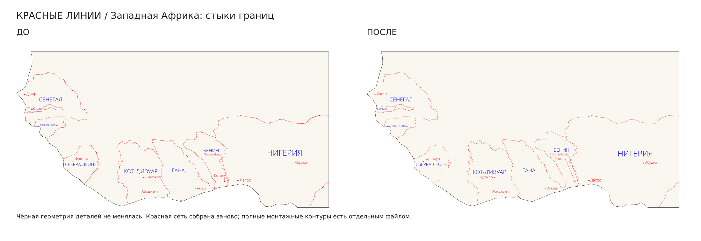

# Африка — исправленная красная разметка

[Полный комплект](Африка-красные-линии-исправлено.zip) · [Крупные примеры до/после](Красные-линии-до-и-после.pdf) · [Твои правки из CDR](CDR-полный-чертёж-исправлено.svg) · [Одна карта, рабочий SVG](Поле-01-740x740.svg) · [Две карты, рабочий SVG](Два-комплекта/Поле-01-740x740.svg)

Перестроена красная географическая разметка. **Сглаженные чёрные контуры деталей, размеры и ориентация сохранены.** В стандартных раскладках по-прежнему 15 физических деталей на карту, шесть слоёв фанеры по 3 мм; два комплекта помещаются на один лист 740 × 740 мм без поворотов и отражений.

## Что исправлено

- Общая граница двух стран строится один раз. Убраны близкие параллельные копии границ и разметки, мелкие «усики» и разрозненные остатки обрезки.
- Красные границы приходят в узел другой линии или в реальный контур резки. Ненужные красные копии вдоль чёрных береговых вырезов убраны.
- Разметка не разрывается вокруг букв: подписи, которым мешала линия, размещены на свободном месте. Все **52 названия стран/территорий и 58 городов** сохранены. В стандартном SVG — 110 редактируемых текстовых объектов на карту.
- Связные участки соединены в непрерывные проходы без повторного движения по одному ребру. Естественные развилки сети остаются развилками: открытая линия границы заканчивается в другой линии или резке, а не замыкается искусственным отрезком.
- Полные физические контуры накладок сохранены **отдельным файлом с явно замкнутыми путями**. В основной разметке совмещённые с резкой участки повторно не гравируются.

## Какой файл открыть

**С твоими изменениями из Corel:**

- `CDR-полный-чертёж-исправлено.svg` — сохранены все исходные чёрные правки, текст и буквенные кривые из присланного CDR, включая вынесенную за страницу копию детали. Заменена тонкая красная географическая разметка. Страница охватывает весь чертёж, фактический масштаб объектов сохранён.
- `Африка-твои-правки-740x740.svg` и `.pdf` — основная раскладка из CDR на странице 740 × 740 мм; вынесенная копия находится только в полном чертеже. Чёрные пользовательские линии сохранены как присланы.

**Проверенный производственный раскрой:**

- `Поле-01-740x740.svg` и `.pdf` — один комплект; 15 деталей, исходные замкнутые чёрные контуры.
- `Два-комплекта/Поле-01-740x740.svg` и `.pdf` — два комплекта; 30 деталей на одном поле.
- `Полные-монтажные-контуры-740x740.svg` в каждом варианте — точные замкнутые контуры непосредственных верхних накладок вместе с чёрной геометрией для совмещения. Красная операция отдельно — `Операции-по-цветам/Красный-полные-монтажные-контуры.svg`. Эти полные монтажные контуры выбираются как отдельная операция; накладывать их повторно на основную красную сеть не требуется.
- `Операции-по-цветам/` — раздельные операции в тех же координатах.

Основной процесс: чёрный — резка, красный — география/города/фактура, синий — названия стран. В стандартных SVG/PDF надписи являются текстом; перед импортом 1:1 в CorelDRAW установить `Шрифт/OpenSans-Light.ttf`. В варианте из CDR буквенные кривые и шрифты сохранены в том виде, в каком присланы.

## Проверки

`Проверка-стыков-красных-линий.json` проверяет географические линии отдельно от букв, фактуры и городских выносок. После исправления **0 свободных географических концов внутри детали и 0 повторных проходов по одному участку**. Геометрия всех 15 деревянных деталей сопоставлена с предыдущей версией и совпадает точно.

`Проверка-раскроя.json` в каждой стандартной раскладке проверяет реально записанные SVG/PDF, замкнутость и сохранность чёрной геометрии, отсутствие наложений, размеры поля и сохранность текста. `Проверка-монтажных-контуров.json` подтверждает явное закрытие всех полных монтажных путей командой `Z`. `Проверка-правок-CDR.json` подтверждает сохранение пользовательских чёрных правок и текста в полном варианте. CorelDRAW здесь не установлен: CDR прочитан через libcdr, редактируемый текст стандартных SVG дополнительно проверен открытием и сохранением в Inkscape.

`Африка-производственная-сборка.blend` обновлена по той же разметке. Сохранены нижние центры деталей, привязка гравировки к верхней поверхности, отдельный материал на каждый слой, водные ступени, цельная пирамида и закрытая полоса у Кении/Эфиопии. Сборка проверена после сохранения.

Данные и генераторы находятся в `data/` и `tools/`; они сохранены в репозитории. Исходный CDR и его прочитанный SVG — в `data/source/`. Исходный Blender и геометрия предыдущей версии также сохранены. Порядок обновления разметки: `rebuild_borders.py` → `clean_structure.py` → `labels.py` → `restore_city_labels.py` → `finalize.py` → `audit_lines.py` → `export.py` → `make_pdf.py` → `verify.py` → `assembly_guides.py`. Для двух комплектов используются прежние `data/layout-multiple.json` и переменные `AFRICA_LAYOUT`, `AFRICA_OUTPUT` как в инструментах экспорта. Для повторного чтения CDR доступен `data/source/Из-CDR.svg`; `fix_user_cdr.py` применяет новую разметку с сохранением прочитанных правок. Толщина слоёв — 3 мм, отметки — 3/6/9/12/15/18 мм.
