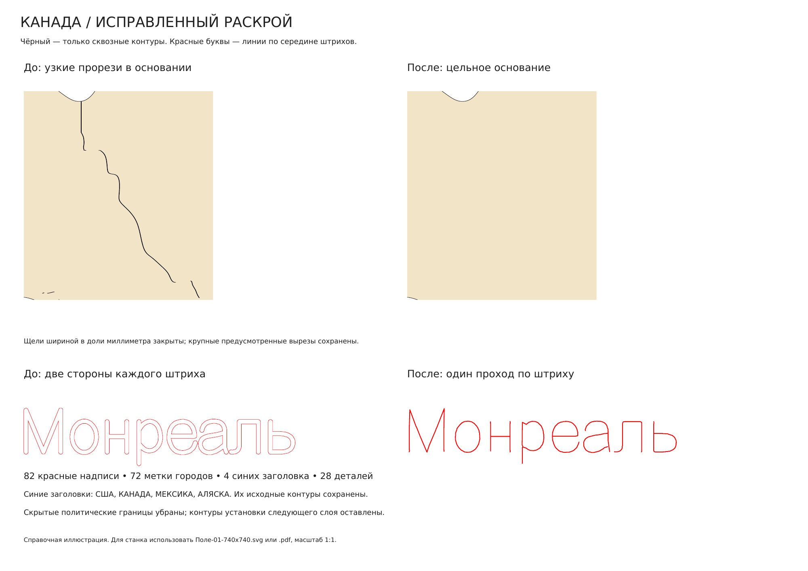

# Канада / Северная Америка — исправленный раскрой 740 × 740 мм

[Скачать комплект](Канада-раскрой-740x740.zip) · [SVG для станка](Поле-01-740x740.svg) · [PDF 1:1](Поле-01-740x740.pdf) · [Изменения крупно](Исправления-крупно.png)

В комплекте **28 деталей на одном листе 740 × 740 мм**: 1 деталь первого слоя, 11 второго и 16 третьего. Каждая физическая деталь — фанера 3 мм. Масштаб исходника сохранён. Детали только перемещены: **без поворотов, отражений и изменения размеров**. Соединённые ранее палочки у «Бойсе — Хелена» остаются одной цельной деталью.

## Цвета и типы линий

| Цвет | Операция |
| --- | --- |
| Чёрный `#000000` | Сквозная резка: внешние контуры и предусмотренные отверстия. Заливки нет. |
| Красный `#FF0000` | Однолинейные надписи, метки городов, видимые политические границы и контуры установки следующего слоя. |
| Синий `#0000FF` | Только **США, КАНАДА, МЕКСИКА, АЛЯСКА**. Исходные заполненные контуры букв сохранены. |

**82 красные надписи преобразованы в настоящие векторные линии по середине штрихов букв.** Это полилинии без заливки, а не две стороны контура шрифта. Использовано исходное начертание без распознавания и перепечатывания. Положение, наклон и размер слов сохранены; не требуется устанавливать шрифт. Замкнутые буквенные петли также передаются одной линией. 72 метки городов сохранены заполненными красными фигурами. Всего сохранены все 158 исходных объектов гравировки. Маленькие названия стран Центральной Америки теперь красные и однолинейные.

Красные надписи и внутренняя разметка имеют обводку 0,05 мм для отображения. В программе станка назначать им проход **по линии**. Синие заголовки и заполненные красные метки допускают гравировку заливкой. Чёрному назначать сквозную резку по контуру. Настройки мощности, скорости и пропила — под свой материал и станок.

## Исправления геометрии и разметки

Закрыты 37 узких паразитных отверстий между исходными областями и три вытянутые щели, в том числе чёрная «волна» на стыке Аляски и Канады. При необходимости добавлена опора в нижнем слое под заполненной щелью. Крупные исходные вырезы, включая каньон, сохранены. Подробности и координаты — в `Исправление-щелей.json`; исходник до ремонта сохранён в `data/source/plan-before-slit-repair.json`.

Политические границы оставлены только на поверхности, видимой после сборки. Под верхними деталями они убраны. На нижнем слое оставлены **контуры установки непосредственного следующего слоя**. Это разметка для сборки, поэтому её не следует назначать сквозной резке. На третьем слое контуров установки четвёртого слоя нет.

## Раскладка

Проверены варианты **2 полных комплекта на 1 листе** и **3 полных комплекта на 2 листах**. Уместить их с целыми основаниями, исходным размером и заданной ориентацией не удалось. Сохранён рабочий вариант **1 полный комплект на 1 листе**. Данные попыток — в `data/layout.json`, дополнительные поиски крупных деталей — в `data/density-*.json`. Это результат поиска раскладки, а не доказательство абсолютной невозможности другой упаковки.

Отступ от края не менее 5 мм; фактический минимальный зазор между деталями — **5,07 мм**. Все позиции и переносы перечислены в `Расположение-деталей.csv`. Схема с номерами — справочная, её не отправлять на станок.

## Файлы

- `Поле-01-740x740.svg` и `.pdf` — полный рабочий лист. Импорт **в миллиметрах, 1:1**, без вписывания в страницу.
- `Операции-по-цветам/` — альтернативные четыре SVG с теми же координатами. Не импортировать одновременно с полным листом, иначе возникнут дубли.
- `Канада-обновлённая-сборка.blend` — обновлённая 3D-геометрия с закрытыми щелями, нижними центрами отсчёта и прежней окраской изделия. Однолинейные операции лазера находятся в SVG/PDF; в Blender надписи показаны как гравировка готового изделия.
- `Исправления-крупно.pdf / .png` — сравнение прорези и текста до/после, справочно.
- `Проверка-раскроя.json` — независимая проверка координат, реально записанных в SVG, цветов, количества надписей, линий и размеров PDF.
- `Проверка-обновлённой-сборки.json` — проверка сохранённого Blender: 28 замкнутых тел, соединённые отростки, нижние центры отсчёта.

Сначала гравировка, затем резка; внутренние отверстия режутся до внешних контуров. Рамки листа и справочных номеров в рабочих файлах нет.

## Воспроизведение

Python-зависимости — в `requirements.txt`. Генераторы: `tools/join_prongs.py` → `tools/repair_slits.py` → `tools/prepare_engraving.py` → `tools/nest.py` → `tools/export.py` → `tools/make_pdf.py` → `tools/verify.py`. Проверка букв: `tools/verify_glyphs.py`. Дополнительный поиск плотности: `tools/density_search.py`, `tools/density_pair_check.py`. Сравнение: `tools/revision_preview.py`. Blender: `tools/build_assembly.py --no-render`, затем `tools/verify_assembly.py`.

Исходные принятые 30 деталей до присоединения палочек сохранены в `data/source/plan-before-joining.json`. Предыдущий проект [canada-production-layers](../canada-production-layers/README.md) сохранён отдельно.
