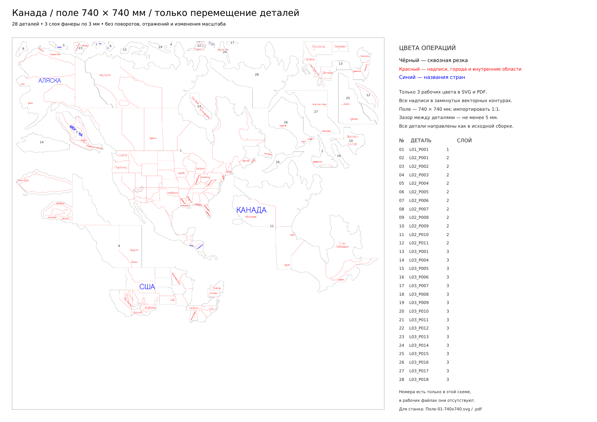

**Канада / Северная Америка — раскрой на поле 74 × 74 см**

[Скачать весь комплект](Канада-раскрой-740x740.zip) · [Рабочий SVG](Поле-01-740x740.svg) · [Рабочий PDF 1:1](Поле-01-740x740.pdf)

Все **28 деталей обновлённой производственной сборки** размещены на **одном поле 740 × 740 мм**. Исходный масштаб сохранён. Детали только перемещены: **без поворотов, отражений, переворачивания и изменения размеров**. Вместе с каждой деталью перенесены её надписи, города и внутренняя разметка. Ориентация всех элементов соответствует исходной сборке.

| Цвет | Что обозначает |
| --- | --- |
| Чёрный `#000000` | Сквозная резка: внешние контуры деталей и реальные отверстия. |
| Красный `#FF0000` | Остальные надписи, метки городов, внутренние политические границы и контуры установки следующего слоя. |
| Синий `#0000FF` | Названия стран и крупная подпись «АЛЯСКА». |

Все 158 исходных надписей и маркеров сохранены. В синюю группу входят 10 названий стран и «АЛЯСКА»; список — в «Синие-названия-стран.csv». Название города «Мехико», остальные города и географические подписи остаются красными.

**Для станка** используйте `Поле-01-740x740.svg` либо `Поле-01-740x740.pdf`. Страница обоих файлов имеет размер 740 × 740 мм. Импортировать в миллиметрах, **1:1**, без вписывания в страницу и автоматического поворота. В рабочих файлах только три заданных цвета; рамка поля и номера деталей в них отсутствуют. Все буквы и метки — в замкнутых векторных контурах, шрифты не нужны.

Чёрные контуры имеют нулевую заливку и тонкую обводку; красная и синяя гравировка представлены замкнутыми заполненными контурами. Внутренняя красная линия — узкая полоса номинальной шириной 0,12 мм, подходящая для гравировки вместе с красными буквами. Она обозначает разметку, сквозную резку ей не назначать. Красные контуры установки верхнего слоя также присутствуют на скрываемой поверхности и помогают при сборке. Геометрия самих деталей при этом не менялась.

В `Операции-по-цветам/` те же данные разделены на четыре файла: чёрная резка, красные надписи и города, красные внутренние области, синие названия. У всех файлов одинаковая страница и положение: при совместном импорте не центрировать каждый файл отдельно. Это альтернативное разделение основного SVG; не импортируйте его поверх полного SVG, чтобы не получить дубли.

Сначала выполняют красную и синюю гравировку, затем сквозную резку; внутренние отверстия режут до внешних контуров. Скорость, мощность и компенсацию пропила задают под свой станок и фанеру. Компенсация ширины реза в этом комплекте не применялась.

Фактический минимальный зазор между деталями **5,07 мм**; ни один контур не выходит за поле, отступ от края не менее 5 мм. Для проверки расположения приложены `Схема-раскладки-с-номерами.pdf / .png` и `Расположение-деталей.csv`. Номера 1–28 в схеме соответствуют исходным именам деталей `L01_P001` и т. п. **Схема с номерами — справочная, её в станок не отправлять.**

Исходная основа — [canada-production-layers](../canada-production-layers/README.md): 1 деталь первого слоя, 11 второго и 16 третьего, толщина всех деталей 3 мм. Две маленькие детали `L03_P002` и `L03_P003` объединены общей перемычкой и присоединены одним отростком к `L03_P001` («Бойсе — Хелена»). Их исходное положение сохранено. Ширина соединений 3,2 мм, они полностью опираются на второй слой. Вместо трёх отдельных деталей получилась одна; остальные контуры сохранены. Никаких новых разрезов основания для раскладки не добавлено.

**Канада-обновлённая-сборка.blend** — обновлённая 3D-сборка с цельными отростками. В Blender показана окраска готовой карты; рабочие цвета лазера заданы в SVG / PDF. `Палочки-до-и-после.pdf / .png` показывают соединение крупно. `Проверка-обновлённой-сборки.json` подтверждает, что объединённый Mesh — одно связное замкнутое тело.

`Проверка-раскроя.json` содержит результат проверки именно записанного SVG: размер страницы, все 28 контуров, отсутствие пересечений и выхода за поле, только перенос исходной геометрии, три цвета и сохранность гравировки после записи координат. Численное отклонение экспортированных контуров находится на уровне округления координат до 0,000001 мм.

Данные и генератор находятся в `data/` и `tools/`. Python-зависимости — в `requirements.txt`. Порядок воспроизведения: `tools/join_prongs.py`, `tools/nest.py`, `tools/export.py`, `tools/make_pdf.py`, `tools/verify.py`. Обновлённая сборка строится через `tools/build_assembly.py --no-render` в Blender с Shapely. Исходный план до объединения палочек сохранён в data/source/plan-before-joining.json. Оригинальные Blender-файлы и прежний комплект не перезаписывались.
