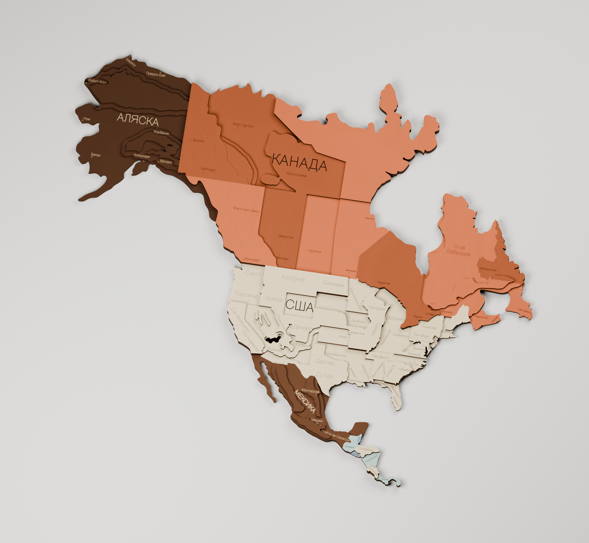
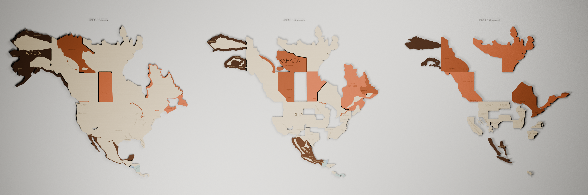

**Северная Америка: слои для резки, покраски и сборки**

[Обновлённый раскрой: 28 деталей с соединёнными палочками, одно поле 740 × 740 мм без поворотов, цвета операций](../canada-cutting-740/README.md).

[Скачать весь комплект одним ZIP](Северная-Америка-слои.zip)

Рабочая сборка подготовлена из пользовательского Blender-файла: [оригинал в релизе model-upload](https://github.com/grebenshhikovau-netizen/-66-/releases/tag/model-upload). Исходный файл не изменён.

Откройте **«Северная-Америка — производственные-слои.blend»**. В нём две сцены: собранная карта и три слоя по отдельности. Получилось **30 деревянных деталей: 1 + 11 + 18**, по 3 мм каждая. Центры деталей расположены на нижней плоскости; надписи привязаны к поверхности, верхние слои следуют за высотой основания.

Сохранены фактические цвета материалов исходника, включая цвета, заданные через узел Brightness/Contrast: Аляска — тёмно-коричневая, Мексика — ореховая, Канада — оранжево-рыжие оттенки, США — натуральная фанера. Юкон исправлен на оранжевый, как Альберта. На тёмных участках визуализация показывает светлую гравировку после окраски.

- **Детали/** — отдельные замкнутые SVG резки, гравировки и разрешённых зон окраски каждой детали.
- **Слой-XX-резка.svg** — замкнутые детали в сборочных координатах.
- **Слой-XX-лазер-без-повторов.svg** — объединённая траектория: общие границы режутся один раз. В этой производной траектории есть открытые отрезки.
- **Слой-XX-гравировка.svg** — только видимые надписи соответствующего уровня; буквы в векторных контурах.
- **Слой-XX-покраска-с-напуском.svg** — разрешённый напуск до 2 мм исключительно под следующим слоем.
- **Слой-XX-сборка.svg**, **Схема-сборки-и-покраски.pdf**, CSV — номера, покрытия и порядок сборки.
- **Маска-Аризона-Мексика.svg**, **Маска-Лабрадор-Квебек.svg** — защита на двух открытых переходах краски единого основания. Последний переход относится к двум исходным оттенкам Канады.

На верхних слоях открытые стыки разных красок разделены по физическим деталям. Во внутренних скрытых областях краски могут перекрываться. NATURAL означает оставить фанеру без цветной краски.

Северная деталь Grand Canyon поднята на второй слой и расширена до 0,5 мм в пределах Аризоны. Исключён одиночный смещённый фрагмент Гондураса возле мирового нуля; сам Гондурас сохранён. Точечное касание контура локально раскрыто на 0,04 мм для замкнутого объёмного тела.

158 исходных надписей и маркеров очищены от дублирующихся импортов. 13 объектов гравировки локально перемещены или уменьшены, чтобы не пересекать ступени; название Мексики повёрнуто вдоль формы страны. Полный журнал находится в отчёте производственных слоёв.

Проверены замкнутость всех тел, отсутствие наложений деталей в одном слое, размещение напуска под верхним слоем, отсутствие открытых стыков разных красок внутри верхних деталей и повторное открытие в Blender 5.2. Шрифты презентации упакованы; рабочая гравировка не зависит от шрифтов. Векторные контуры имеют исходный масштаб примерно 509,81 × 434,70 мм. Компенсация ширины лазерного реза и раскладка по формату листа не выполнены; требуется пробная резка под конкретный материал и станок.

Данные и воспроизведение: `extracted.json` содержит проекции исходных объектов и фактические цвета материалов, `production-plan.json` — детали, видимые поверхности и зоны окраски. `tools/plan.py` строит план; затем выполняются `fit_mexico_label.py`, `finish_production.py`, `verify_vectors.py`, `make_guide.py`, `build_production.py`. Для геометрии нужны Python, Shapely 2.1, lxml и reportlab; для Blender-скрипта — Blender 4.3+ с Shapely, установленным для встроенной версии Python. Объединение деталей основано на допустимых стыках цветов и связности, глобальный математический минимум деталей не заявляется.
