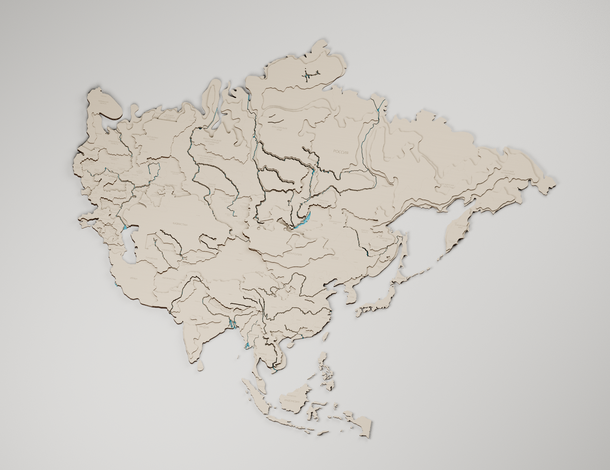
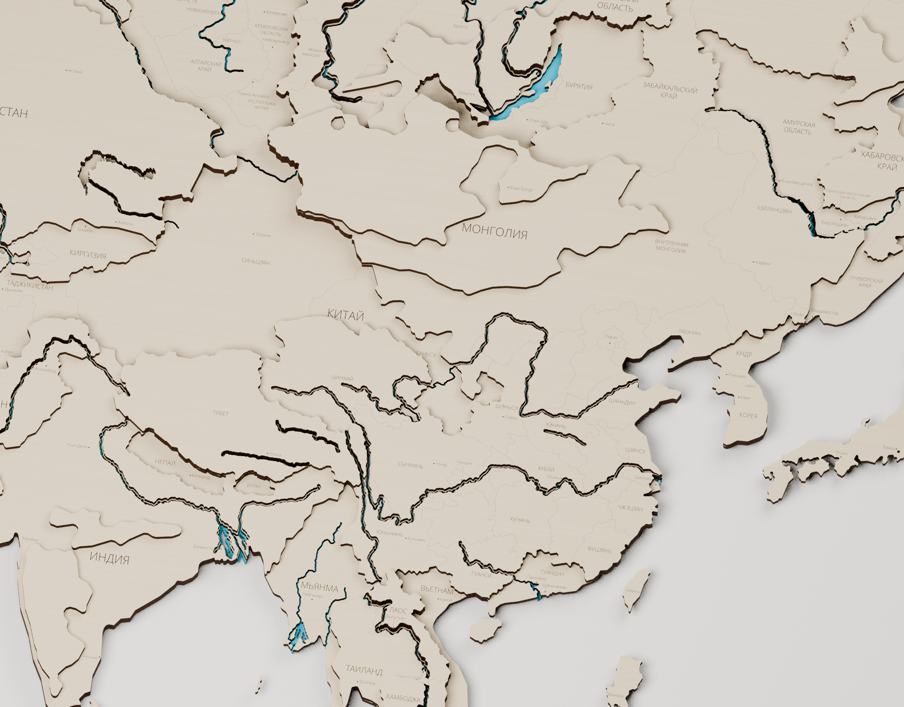

# Россия + Азия

**74 деталей, 2 листа 740 × 740 мм.** Слои: **41 + 13 + 19 + 1**; верхние отметки **3 / 6 / 9 / 12 мм**, толщина каждого листа фанеры 3 мм. Ориентация и масштаб сохранены: раскладка выполняет только перенос.

- Лист 1: [Россия-Азия-лист-01-740x740.svg](Россия-Азия-лист-01-740x740.svg) · [PDF 1:1](Россия-Азия-лист-01-740x740.pdf)
- Лист 2: [Россия-Азия-лист-02-740x740.svg](Россия-Азия-лист-02-740x740.svg) · [PDF 1:1](Россия-Азия-лист-02-740x740.pdf)

[Сборка Blender](Сборка-комплекта.blend) · [Слои и сборка](Слои-и-сборка.pdf) · [Раскладка с номерами](Схема-раскладки-с-номерами.pdf)

## Физическое объединение

Соседние участки одинаковой высоты действительно объединены в общие замкнутые деревянные детали. Это не простая совместная раскладка прежних независимых файлов. Число крупных деталей, содержащих дерево из обеих исходных моделей этого комплекта: **5**; их IDs и слои перечислены в Проверка-физического-объединения.json. Утверждённые высоты и крупные очертания сохранены; несущественные новые речные осколки меньше 40 мм² убраны, а прежние маленькие вершины и острова сохранены.

Видимые разделения для покраски сохранены там, где они совместимы со сквозными руслами. По выбору пользователя накладки «Лаос + Камбоджа» третьего слоя и «Венгрия + Румыния + Сербия» второго слоя сохранены цельными: через соответствующие реки добавлены небольшие деревянные перемычки шириной 2,2 мм. Нижний пропил остаётся сквозным. В остальных местах верхние русла открыты. [Схема перемычек](Перемычки-на-реках.pdf).

В комплект входят Россия, Казахстан, Иран, Индия, Китай и остальные страны основной Азии. Скандинавия, Турция, Левант и Аравийский полуостров перенесены во второй комплект. В основании есть **1 технологический стык** под размер поля станка; при выборе места учитывалось перекрытие верхними слоями. Он частично скрыт накладками; видимая часть и длина записаны в отчёте, стык не выдаётся за полностью скрытый.

В Китае добавлена **гравировка границ провинций**, без новых разрезов по провинциальным границам; подписаны 20 крупных регионов и основные города. Общий рельеф Китая не заменялся новой топографией.

## Реки, гравировка и файлы

Речные и озёрные вырезы проверены во всех уровнях. В основании сохраняется узкий профиль, в накладках — утверждённый более широкий береговой профиль. Верхние русла, прежде перекрытые деревом, открыты. Исключения — согласованные верхние перемычки в двух накладках и цельная пирамида Египта. Синее под водой в Blender — справочное оргстекло; его отдельный контур не входит в фанерный раскрой. [Сечение ступеньки](Водные-ступени.pdf).

Всего **265 редактируемых надписей**, из них 132 городов с метками. Все прежние подписи сохранены; у прорезей слова перенесены целиком на открытые поверхности. Некоторые городские выноски опущены там, где прямая линия пересекала бы реку или другую высотную ступень; сама метка города остаётся на ближайшем берегу.

- **Чёрный** `#000000`: сквозная резка — только реальные замкнутые периметры и отверстия.
- **Красный** `#FF0000`: города, области, видимые границы и монтажная разметка ближайшего верхнего слоя.
- **Синий** `#0000FF`: названия стран.

Установить `Шрифт/OpenSans-Light.ttf` и импортировать SVG в миллиметрах, 1:1. Текст не переведён в кривые. PDF имеет страницу 740 × 740 мм и встроенный шрифт; при импорте выбирать текст как текст. CorelDRAW здесь не установлен; SVG дополнительно открывается и сохраняется в Inkscape для проверки сохранности текста.

Схема с номерами и схемы сборки — справочные; у рабочих SVG/PDF нет рамки резки и справочных номеров. Таблица деталей показывает блок и группу покраски. В Blender каждый деревянный объект замкнут и связен, начало отсчёта на нижней плоскости; гравировка следует за верхом. Минимальный измеренный междетальный зазор: **4.48 мм**; отступ от края поля не меньше 5 мм.

## Проверки

`Проверка-раскроя.json` проверяет фактически записанные SVG/PDF: замкнутость, совпадение геометрии, отсутствие наложений и выхода за поле, перенос без вращения, редактируемый текст, открытые водные каналы во всех слоях и сохранение рельефа вне воды. `Проверка-стыков-красных-линий.json` подтверждает отсутствие оборванных географических концов и повторных проходов. `Проверка-сохранённого-Blender.json` проверяет сохранённый файл, связность тел, нижние центры и поведение при высоте основания 3 / 6 / 9 мм.

Источники и генераторы находятся в родительском каталоге проекта. Утверждённые исходные планы сохранены сжатыми в `data/source/`; их SHA-256 записаны в sources.json. Зависимости — requirements.txt. Порядок пересборки из корня: country_partition_masks.py → plan_combined.py → remove_new_water_shards.py → add_selected_river_bridges.py → setup_batches.py. Затем для каждого комплекта nest.py → rebuild_network.py → clean_structure.py → annotations.py → finalize.py → audit_lines.py → export.py → make_pdf.py → verify.py → build_assembly.py --no-render → verify_assembly.py → render_views.py → bridge_reference.py. В конце из корня выполнить deliverables.py → check_text_and_previews.py → package.py. Лицензия шрифта включена.
