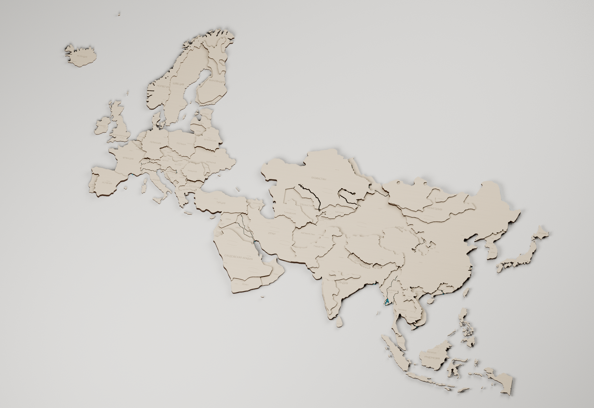
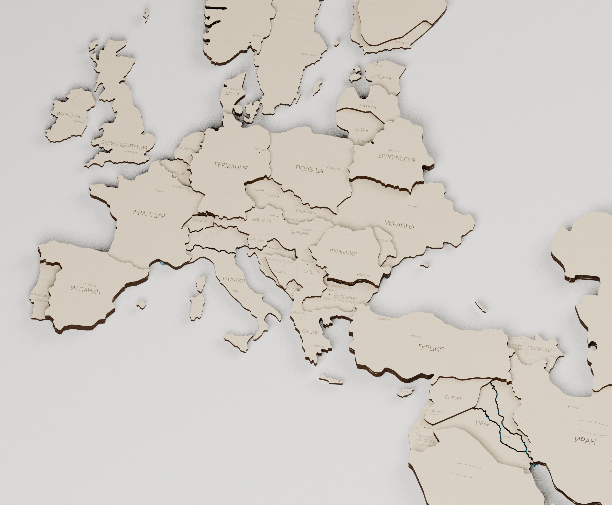

# Евразия — актуальная сборка с группами покраски

[Скачать комплект](Евразия-актуальная-исправлено-740x740.zip) · [Рабочий SVG](Поле-01-740x740.svg) · [PDF 1:1](Поле-01-740x740.pdf) · [Blender](Евразия-производственная-сборка.blend)

**79 деталей на одном листе 740 × 740 мм**, без поворотов, отражений и изменения масштаба. Четыре фактических уровня из «Евразия-политическая.blendактуалочка.blend»: **3 / 6 / 9 / 12 мм**. По слоям: **56 + 7 + 15 + 1**. Исходных деревянных объектов — 227.

## Соединения и покраска

- **Австрия, Франция и Польша** входят в одну связную деталь второго слоя: `L02_P003`. Остальные соединяющие участки этого массива сохранены.
- **Венгрия** — отдельная деталь второго слоя `L02_P012`.
- **Греция, Албания, Турция, Иран и Сирия** — одна связная деталь второго слоя `L02_P001`; третий слой Турции сохранён без изменения геометрии и высоты 9 мм. Шов Греции и Албании с Сербией остаётся, лишние стыки Турции с Ираном и Сирией удалены.
- **Туркмения** отделена от Казахстана только в третьем слое: L03_P009.
- **Лаос и Камбоджа** объединены в одну деталь третьего слоя, отдельно от Китая: L03_P014.

Первый и второй слои Туркмении и Казахстана общие. Во втором слое Лаос и Камбоджа соединены с Таиландом, Китаем и общим восточным массивом. Основание не разрезано по этим границам. Остальные соединённые участки одинаковой высоты объединены в крупные детали. Настоящие острова сохраняются отдельно. Дополнительные разделения сделаны по общим стыкам с точностью сетки 0,001 мм, без добавления полосового зазора. Сглаживание основного силуэта не менялось ради отдельных цветов. В Blender у каждой группы каждого слоя свой независимый материал; стандартная сборка показана светлой фанерой.

[Схема групп покраски — 5 страниц](Группы-покраски.pdf) · [Таблица деталей и групп](Группы-покраски.csv). Цвета на справочной схеме служат для различения групп, а не задают обязательное покрытие.

## Контуры, реки и текст

Мелкие зубцы приглажены, случайные микрофрагменты убраны. Базовое упрощение 0,24 мм, закрытие служебных щелей радиусом 0,5 мм, скругление выступов 0,3 мм; финальное упрощение основных слоёв 0,02 мм. Число узлов исходных объединённых контуров: 91,248; в готовых контурах всех деталей, включая повторяющиеся стороны новых стыков: 30,532. Мелкие детали не добавлялись ради заполнения пространства.

В первом слое — узкие сквозные прорези **21 основной речной системы** из проекта: номинально 0,65 мм, Амур и Иртыш 0,8 мм. Существующие широкие верхние вырезы сохранены; целые верхние участки остаются целыми, поэтому нижняя щель местами закрыта верхней фанерой. Новых верхних каналов через целые участки не добавлено. Служебные численные щели тоньше примерно 0,24 мм не восстанавливаются как водные вырезы. Синий материал под прорезями — справочное оргстекло, не отдельная производственная деталь.

**156 настоящих текстовых объектов**: 82 названия стран и территорий, 74 города. В самых маленьких странах подписи пропущены по размеру, причины сохранены в данных. Чёрный — сквозная резка, красный — города, метки и видимые внутренние линии, синий — названия стран. Красная сеть состыкована: 0 свободных географических концов и 0 повторных проходов. Скрытые границы удалены. Полные замкнутые монтажные формы непосредственного следующего слоя вынесены в отдельный справочный файл.

Для CorelDRAW установить `Шрифт/OpenSans-Light.ttf` и импортировать SVG в миллиметрах, 1:1. Все надписи в SVG сохранены текстом. PDF имеет страницу 740 × 740 мм и встроенный шрифт; при импорте выбирать текст. CorelDRAW здесь не установлен, SVG дополнительно проверен открытием/сохранением в Inkscape.

## Файлы и проверки

Архив содержит рабочие SVG/PDF, отдельные операции по цветам, схемы слоёв, справочную нумерацию, таблицы, шрифт, сборку Blender, изображения и отчёты. Схема с номерами и цветная схема групп — справочные файлы. Минимальный измеренный зазор раскладки — **4.26 мм**, отступ от поля не меньше 5 мм. Крупнейший материковый контур помещается без дополнительного шва.

В Blender каждое тело замкнуто и связно, центры снизу. Гравировка следует за верхом; накладки следуют за опорными слоями. Проверяются изменения высоты основания на 3 / 6 / 9 мм. Отчёты: `Проверка-раскроя.json`, `Проверка-групп-покраски.json`, `Проверка-сохранённого-Blender.json`, `Проверка-стыков-красных-линий.json`, `Проверка-текста.json`.

Исходник с SHA-256, географические данные и генераторы доступны в [репозитории](https://github.com/grebenshhikovau-netizen/-66-/tree/main/eurasia-current-cutting-740). Предыдущая Евразия сохранена отдельно. Зависимости — requirements.txt; извлечение исходника требует bpy, совместимого с Blender 5.2. Порядок: extract_source.py → plan.py → paint_partitions.py → restore_eastern_second_ply.py → restore_common_supports.py → rebuild_borders.py → clean_structure.py → labels.py → restore_city_labels.py → finalize.py → audit_lines.py → nest.py → assign_assembly_guides.py → export.py → make_pdf.py → verify.py → assembly_guides.py → verify_paint_groups.py → paint_group_reference.py. Затем build_assembly.py --no-render, verify_assembly.py, render_assembly.py. Лицензия шрифта включена.
