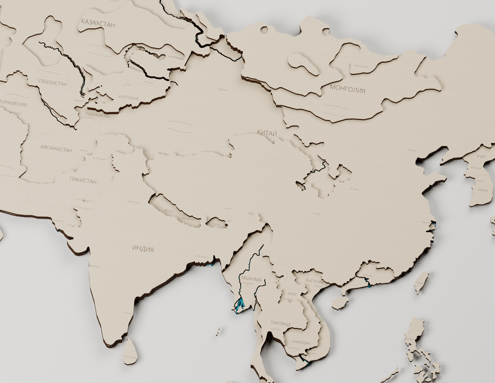
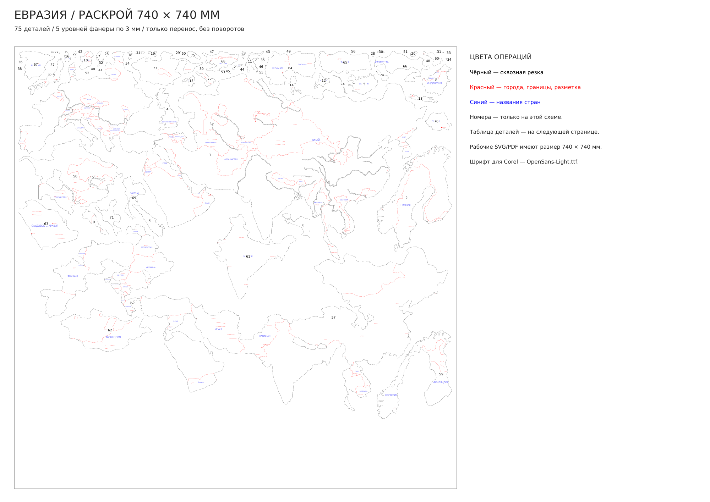

# Евразия — объединённые слои и раскрой 740 × 740 мм

[Скачать комплект](Евразия-раскрой-740x740.zip) · [Рабочий SVG](Поле-01-740x740.svg) · [PDF 1:1](Поле-01-740x740.pdf) · [Blender](Евразия-производственная-сборка.blend)

**Один полный комплект — 75 деталей на одном листе 740 × 740 мм.** По слоям: **56 + 4 + 12 + 2 + 1**. Детали только перемещены: без поворотов, отражений и изменения масштаба. Сохранены фактические высоты из присланного «Евразия-политическая.blend»: **3 / 6 / 9 / 12 / 15 мм**, пять слоёв фанеры по 3 мм.

## Объединение и сглаживание

Из 234 исходных деревянных объектов собраны крупные цельные детали по фактической высоте. Общие политические стыки объединены; настоящие острова остаются отдельными. Большинство деталей основания приходится на острова Европы, Японии, Индонезии и Филиппин. Искусственные перемычки через море не добавлялись.

Сглажены мелкие зубцы и избыточные изгибы. Базовое упрощение 0,24 мм, закрытие узких служебных щелей радиусом 0,5 мм, скругление мелких выступов радиусом 0,3 мм. После водных вырезов дополнительно убраны хрупкие микростыки и касания контуров в одной точке; соприкасающиеся отверстия объединены корректно. Финальное упрощение контуров — 0,02 мм.

Количество точек в контурах деревянных слоёв: **87,740 → 27,594**, примерно **на 69% меньше**, включая добавленные реки. Минимальная площадь обычного отдельного элемента основания — 4 мм², верхней накладки — 9 мм². Численные микрофрагменты и несущественные скрытые речные островки убраны. Внутренние данные и параметры сохранены для дальнейшей настройки.

## Реки: узкая щель в первом слое

Включены **все 21 основные речные системы из данных проекта**: Дунай, Рейн, Рона, По, Янцзы, Хуанхэ, Чжуцзян, Меконг, Ганг, Брахмапутра, Инд, Иравади, Салуин, Тигр, Евфрат, Шатт-эль-Араб, Амур, Иртыш, Или, Сырдарья и Амударья.

В первом слое сделаны сквозные прорези номинальной шириной **0,65 мм**, для Амура и Иртыша — **0,8 мм**. На поворотах контуры приглажены. Устья и соединения доведены; проверены слияния Ганга с Брахмапутрой, Тигра с Евфратом и Шатт-эль-Арабом.

**Существующие выразительные верхние вырезы сохранены; целые верхние участки оставлены целыми.** Поэтому на части карты видна ступенька, а под целой накладкой нижняя щель может перекрываться деревом сверху. Дополнительные верхние русла через целую фанеру не вырезались. Численные служебные зазоры тоньше примерно 0,24 мм не восстанавливались как отдельные верхние водные вырезы.

Новых озёр в целых плитах не добавлено; исходные береговые формы и существующие водные проёмы сохранены. Синий материал в Blender — справочное оргстекло под прорезями, не фанерная деталь и не производственный контур листа оргстекла.

[Схема водной ступеньки и целой верхней накладки](Водные-ступени.pdf)

## Текст и цвета операций

Добавлены **82 названия стран и территорий** и **74 города с метками**. Все **156 надписей — обычный редактируемый текст** в SVG/PDF. В самых маленьких странах города пропущены. Подписи физически слишком маленьких территорий также пропущены; причины записаны в данных. Короткие названия «ОАЭ» и «В. ТИМОР» использованы для компактного размещения.

| Цвет | Назначение |
| --- | --- |
| Чёрный `#000000` | Замкнутые периметры и отверстия для сквозной резки. |
| Красный `#FF0000` | Города, метки, видимые границы, декоративная фактура и сборочная разметка. |
| Синий `#0000FF` | Названия стран и территорий. |

Общая красная сеть построена со стыковкой линий. При проверке — **0 свободных географических концов внутри деталей**, повторных проходов по одному участку нет. Границы под накладками удалены. Надписи размещены на открытых поверхностях с отступом от линий; буквы не обрезаны. Городские выноски и декоративная фактура учитываются отдельно от географических границ.

Полные физические контуры непосредственного следующего слоя экспортированы отдельно в справочный файл `Полные-монтажные-контуры-740x740.svg`; все такие контуры явно замкнуты. Каждая из 19 верхних деталей показана один раз на своей основной опоре, включая участки над нижними речными прорезями. Красная операция без остальных линий — `Операции-по-цветам/Красный-полные-монтажные-контуры.svg`.

**Для CorelDRAW установить `Шрифт/OpenSans-Light.ttf`, затем импортировать SVG в миллиметрах, 1:1.** PDF имеет страницу 740 × 740 мм и встроенный текстовый шрифт; при импорте выбирать текст как текст. Надписи не переведены в кривые. Сохранность текста проверена открытием/сохранением SVG в Inkscape; CorelDRAW здесь не установлен.

## Файлы и сборка

- `Поле-01-740x740.svg` и `.pdf` — рабочая раскладка одного полного комплекта, без справочных номеров и рамки резки.
- `Операции-по-цветам/` — отдельные операции в тех же координатах.
- `Схема-раскладки-с-номерами.pdf` — справочная раскладка и отдельная страница соответствия номеров деталям; не рабочий файл резки.
- `Слои-и-сборка.pdf` — пять слоёв в положении сборки. `Расположение-деталей.csv`, `Надписи.csv`, `Города.csv` — координаты и состав.
- `Евразия-производственная-сборка.blend` — 75 отдельных связных замкнутых тел. Центры на нижней плоскости, гравировка следует за верхней поверхностью, верхние слои следуют за опорами. На каждый слой свой материал для окраски. Есть сцены собранной карты и разложенных слоёв.

Минимальный измеренный зазор между деталями — **4.39 мм**, отступ от края поля не меньше 5 мм. Габарит карты в исходном масштабе — около 805 × 538 мм; отдельные географические части размещены на поле переносом. Крупнейшая материковая деталь проходит в поле без дополнительного шва. Пробовалось размещение нескольких комплектов на одном листе; проверенный вариант — один комплект.

## Проверки и данные

`Проверка-раскроя.json` проверяет фактически записанные SVG/PDF: размер страницы, замкнутую корректную резку, отсутствие наложений и выхода за поле, перенос без изменения ориентации, текст и его открытые поверхности. Отдельно проверяются нижние водные прорези, сохранение существующих верхних вырезов, отсутствие новых верхних разрезов через целые участки и допустимые мостики над узкой нижней прорезью.

`Проверка-сохранённого-Blender.json` подтверждает 75 отдельных связных замкнутых тел толщиной 3 мм, нижние центры, совпадение проекций с планом и привязку гравировки при изменении высоты основания на 3/6/9 мм. `Проверка-стыков-красных-линий.json`, `Проверка-монтажных-контуров.json` и `Проверка-текста.json` описывают дополнительные проверки.

Исходный Blender сохранён в `data/source/Исходная-сборка.blend`, контрольная сумма — `source-info.json` рядом с ним. В `data/source/` также находятся географическая проекция, опорные русла и политические контуры проекта. Данные и генераторы доступны в [репозитории](https://github.com/grebenshhikovau-netizen/-66-/tree/main/eurasia-cutting-740); архив для скачивания содержит готовые файлы, шрифт, схемы и обновлённую сборку.

Зависимости — `requirements.txt`. Для повторного извлечения исходника требуется bpy, совместимый с Blender 5.2. Основной порядок: `extract_source.py` → `plan.py` → `rebuild_borders.py` → `clean_structure.py` → `labels.py` → `restore_city_labels.py` → `finalize.py` → `nest.py` → `audit_lines.py` → `assign_assembly_guides.py` → `export.py` → `make_pdf.py` → `verify.py` → `assembly_guides.py`. Затем `build_assembly.py --no-render`, `verify_assembly.py`, `render_assembly.py` в Blender 4.3+. Скрипты находятся в `tools/`; запускаются из каталога проекта. Шрифт Open Sans распространяется по Apache License 2.0; лицензия включена.
