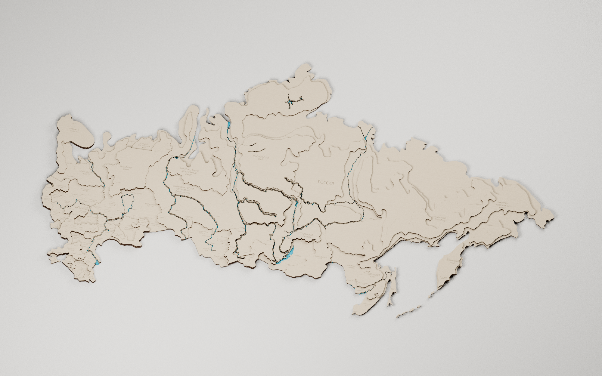

# Россия — актуальная сборка, раскрой 740 × 740 мм

[Скачать комплект](Россия-актуальная-раскрой-740x740.zip) · [SVG](Поле-01-740x740.svg) · [Blender](Россия-производственная-сборка.blend)

Исходник: «Россия-политическая.blend АКТУАЛОЧКА.blend». Сохранены три фактических уровня 3 / 6 / 9 мм. **33 физических деталей**, по слоям **9 + 12 + 12**, вместо 231 исходного деревянного объекта. Раскладка — 1 лист 740 × 740 мм, без поворотов, отражений и изменения масштаба.

Мелкие зубцы сглажены, соседние участки одной высоты объединены. Базовое упрощение 0,24 мм, закрытие служебных щелей радиусом 0,44 мм, скругление выступов радиусом 0,30 мм. Число точек: 101,319 → 78,291. Острова не соединены перемычками через море. Незначительные мелкие остатки удалены; крупные формы сохранены. Параметры площади и сглаживания доступны в data/parameters.json.

В первом слое речные прорези примерно вдвое уже верхних: 0,8 мм, для Оби, Енисея и Лены 0,9 мм. Байкал и Таймыр имеют нижние узкие сквозные профили. Новых вырезов озёр Карелии нет. Синий материал Blender обозначает справочное оргстекло под водой.

172 надписи — обычный редактируемый текст: страна, регионы и 90 городов. Чёрный — сквозная резка, красный — области, города и видимая разметка, синий — РОССИЯ. Для Corel установить Шрифт/OpenSans-Light.ttf и импортировать SVG в миллиметрах 1:1. CorelDRAW здесь не установлен; SVG содержит настоящие текстовые объекты.

Общие красные линии состыкованы в сеть, параллельные дубли удалены. Надписи размещены рядом с линиями, без разрывов географических границ ради текста. Скрытые политические границы удалены. Полные замкнутые монтажные формы следующего слоя вынесены отдельно в справочный Полные-монтажные-контуры-740x740.svg.

В архиве рабочие SVG/PDF 1:1, отдельные операции по цветам, схемы слоёв, нумерация деталей, таблицы, шрифт, проверенная сборка Blender и отчёты. Схема с номерами справочная. В Blender центры снизу, гравировка следует за верхом, накладки следуют за опорами.

Проверка-раскроя.json проверяет фактически записанные SVG/PDF, размеры, замкнутость, отсутствие наложений, текст и водные ступени. Проверка-сохранённого-Blender.json проверяет замкнутые связные тела и нижние центры. Проверка-стыков-красных-линий.json проверяет стыки и повторные проходы.

Исходник и SHA-256 сохранены в data/source/. Генераторы и данные доступны в репозитории russia-current-cutting-740. Порядок: extract_source.py → plan.py → clean_structure.py → labels.py → nest.py → remove_micro_islets.py → refine_taymyr.py → clean_structure.py → finalize.py → audit_lines.py → assign_assembly_guides.py → export.py → make_pdf.py → verify.py → assembly_guides.py. Затем build_assembly.py --no-render, verify_assembly.py, render_assembly.py. Python-зависимости — requirements.txt; извлечение исходника требует bpy, совместимого с Blender 5.2. Лицензия шрифта приложена.
