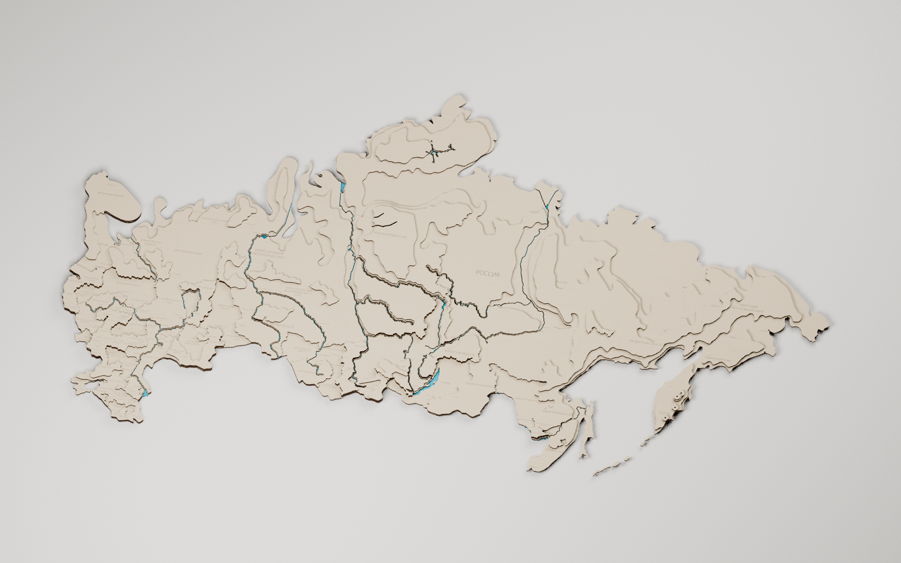
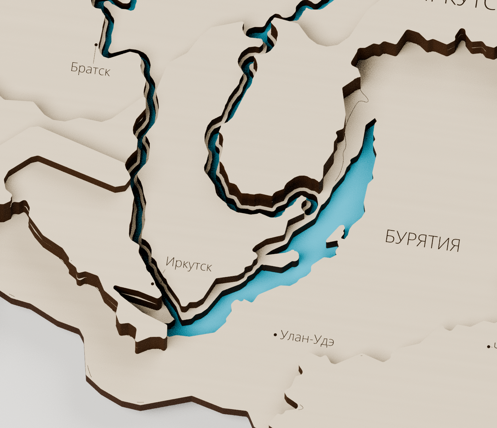
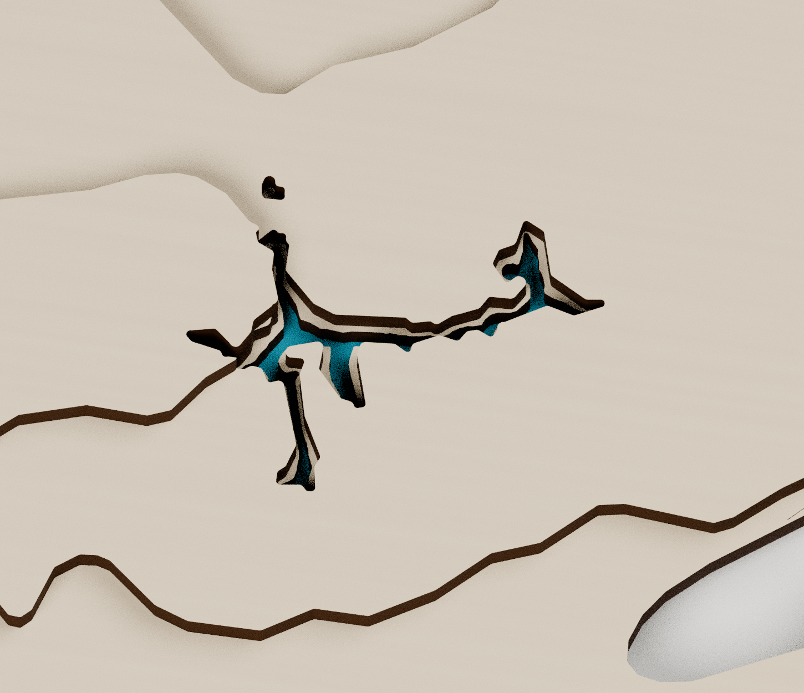
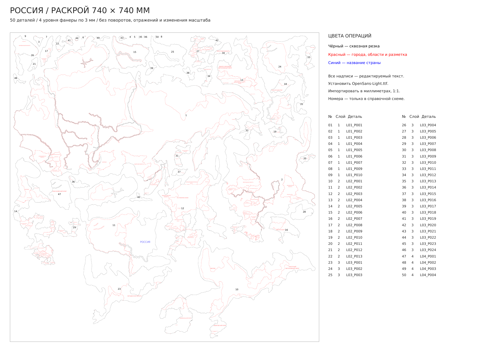

# Россия — слои для резки на поле 740 × 740 мм

[Скачать комплект](Россия-раскрой-740x740.zip) · [Рабочий SVG](Поле-01-740x740.svg) · [PDF 1:1](Поле-01-740x740.pdf) · [Blender](Россия-производственная-сборка.blend)

**Один полный комплект — 50 деталей на одном листе 740 × 740 мм.** Детали только перемещены: без поворотов, отражений и изменения масштаба. Сохранены выбранные пользователем высоты из «Россия-политическая.blend»: четыре уровня фанеры по 3 мм, верхние отметки 3 / 6 / 9 / 12 мм. По слоям: **9 + 13 + 24 + 4 детали**. Габарит собранной карты — примерно 770,89 × 391,41 мм; для размещения на листе масштаб карты не уменьшался.

## Контуры и монолитность

Соседние области объединены в крупные физические детали по фактической высоте. Россия рассчитана на один цвет; политические швы не разделяют детали, если это не требуется геометрией. Настоящие острова сохранены отдельно. Убраны незначительные изолированные остатки рельефа и два неподдерживающих верхние слои речных островка площадью 15,35 и 6,22 мм². Новые стыки ради формата листа не добавлялись.

Мелкие зубцы и впадины скруглены: исходное упрощение 0,24 мм, закрытие узких щелей радиусом 0,44 мм и скругление/удаление мелких выступов радиусом 0,30 мм. Сохранены крупные очертания областей и выбранная высота каждой зоны. Общие линии политических границ сглажены согласованно, с сохранением узлов стыков.

[Сравнение до и после](Сглаживание-до-и-после.pdf) · [Слои в положении сборки](Слои-и-сборка.pdf)

## Реки, Байкал и Таймыр

В первом слое сделаны узкие сквозные прорези: основные русла **0,8 мм**, Обь, Енисей и Лена — **0,9 мм**. В верхних слоях соответствующие русла шире: **1,6 и 1,8 мм**. Получается береговая ступенька там, где над основанием есть следующий слой. Исходные высоты ради ступеньки не повышались.

Байкал и **озеро Таймыр** имеют сквозную нижнюю часть, более узкую, чем верхняя. Байкал сохраняет вытянутую изогнутую форму; профиль Таймыра сужен по локальной ширине, чтобы сохранить его длинные заливы. Проверены соединения Ангары с Байкалом и Енисеем, Иртыша с Обью, Вилюя с Леной, Камы с Волгой. Новых сквозных озёр в Карелии не добавлено.

[Схема водных ступеней](Водные-ступени.pdf). Синий материал в Blender — справочная визуализация оргстекла под водой; он не входит в число фанерных деталей. Отдельный производственный контур оргстекла здесь не проектировался.

## Надписи и цвета операций

В рабочем SVG **172 настоящих текстовых объекта**: 90 городов, 81 региональная подпись и название страны. Названы все 84 региона исходной модели: три городских региона обозначены самими городами. Исходные региональные названия сохранены и дополнены; усечённые имена развёрнуты. Добавлены 90 красных меток городов. Если координата попадала в прорезь реки, метка сдвигалась на ближайший берег; максимальный сдвиг 1,49 мм, значения записаны в `Города.csv`.

| Цвет | Операция |
| --- | --- |
| Чёрный `#000000` | Реальные замкнутые контуры сквозной резки: периметры деталей и отверстия. |
| Красный `#FF0000` | Города, метки, названия регионов, видимые политические границы и ориентиры установки непосредственного следующего слоя. |
| Синий `#0000FF` | Название «РОССИЯ», обычным текстом. |

Каждая надпись целиком находится на одной открытой поверхности; буквы не обрезаны границами. В тесных местах применены линии-выноски. Политические границы под верхними слоями удалены. Разметка установки относится только к непосредственному следующему слою; на самом верхнем слое её нет.

**Для редактирования в CorelDRAW установите `Шрифт/OpenSans-Light.ttf` и импортируйте SVG в масштабе 1:1.** PDF имеет страницу 740 × 740 мм и встроенный текстовый шрифт; при импорте выбирайте текст как текст. Надписи не переведены в кривые и не являются однолинейной имитацией шрифта. CorelDRAW в этой среде отсутствует; сохранность всех 172 текстовых объектов проверена открытием и повторным сохранением SVG в Inkscape.

## Файлы и сборка

- `Поле-01-740x740.svg` и `.pdf` — рабочие файлы 1:1; без рамки резки и справочных номеров.
- `Операции-по-цветам/` — четыре SVG с теми же координатами: чёрная резка, красная разметка, красный текст/метки, синее название.
- `Схема-раскладки-с-номерами.pdf` — справочные номера 1–50; **не отправлять эту схему на резку**. Связь номера, уровня и детали — в `Расположение-деталей.csv`.
- `Слои-и-сборка.pdf` — четыре слоя в положении сборки. `Надписи.csv` и `Города.csv` — текст и координаты.
- `Россия-производственная-сборка.blend` — 50 отдельных замкнутых тел, сцены собранной карты и слоёв. Все центры отсчёта на нижней плоскости. Гравировка привязана к верху; высота опорных деталей управляет положением верхних.

Минимальный измеренный зазор между деталями на листе — **4,62 мм**; отступ от края не меньше 5 мм. Размеры модели и раскроя сохранены. Значения мощности, скорости резки и компенсация ширины лазерного реза остаются настройками станка.

## Проверки и воспроизведение

`Проверка-раскроя.json`: проверены реально записанные SVG/PDF, 50 замкнутых корректных контуров, отсутствие наложений и выхода за поле, перенос без изменения ориентации, размеры страницы, три цвета операций, редактируемый текст, отсутствие наложения слов, опора верхних слоёв, отверстия и соединения водных систем.

`Проверка-сохранённого-Blender.json`: каждая деталь — одно связное замкнутое тело, толщина 3 мм, нижний центр, совпадение проекции с планом; проверены привязки гравировки и поведение при изменении высоты основания на 3 / 6 / 9 мм. `Проверка-сглаживания-и-воды.json` содержит параметры и статистику, `Таймыр-профиль.json` — проверку нижнего контура озера.

Исходник и генераторы сохранены в [репозитории](https://github.com/grebenshhikovau-netizen/-66-/tree/main/russia-cutting-740): `data/source/Исходная-сборка.blend`, SHA-256 — в `data/source/source-info.json`. Архив для скачивания содержит готовые файлы, шрифт, схемы и обновлённую сборку; внутренние данные генератора остаются в репозитории.

Зависимости — `requirements.txt`. Извлечение исходной геометрии: `tools/extract_source.py` с Blender/Python bpy, совместимым с исходником Blender 5.2. Из сохранённых данных: `plan.py` → `labels.py` → `nest.py` → `remove_micro_islets.py` → `refine_taymyr.py` → `finalize.py` → `export.py` → `make_pdf.py` → `verify.py`. Затем `build_assembly.py --no-render` и `verify_assembly.py` в Blender 4.3+, `render_assembly.py` для изображений. Скрипты находятся в `tools/`; запускаются из каталога проекта. Географическая проекция и исходные справочные русла сохранены в `data/source/`. Шрифт Open Sans распространяется по Apache License 2.0; лицензия включена.
