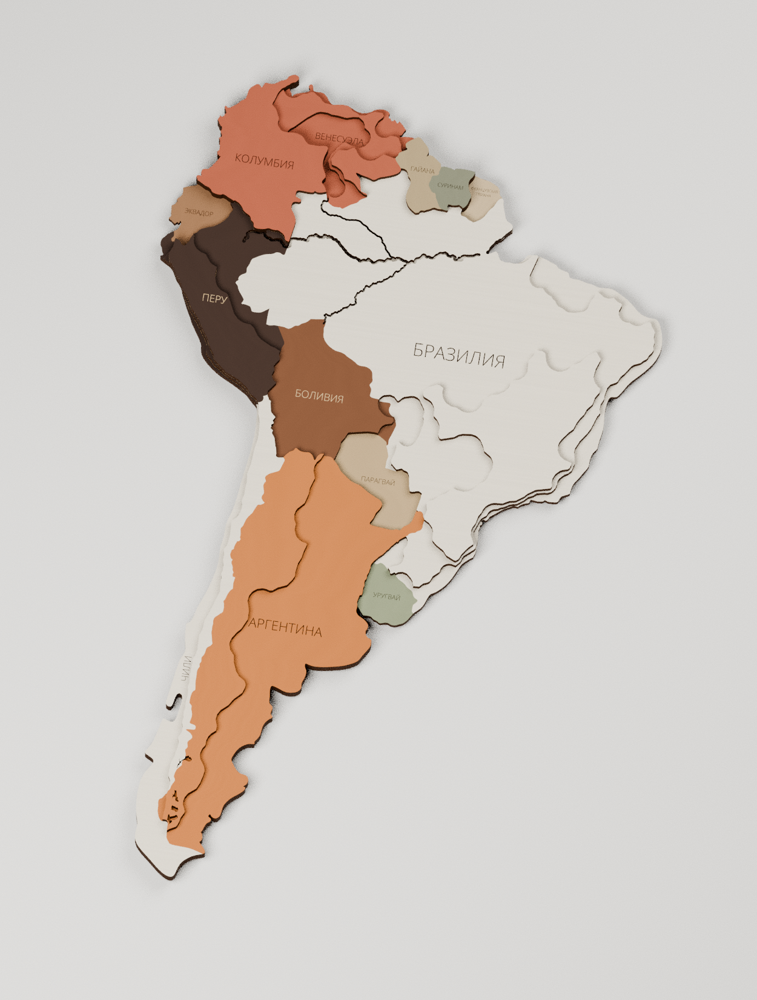
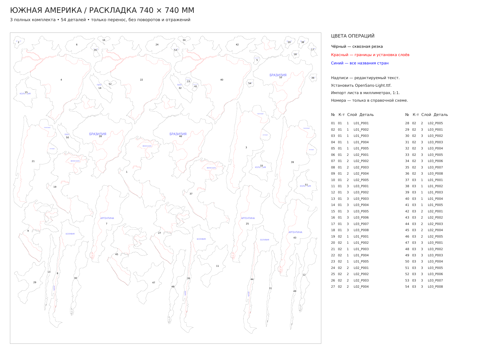

# Южная Америка — производственные слои и раскрой 740 × 740 мм

[Скачать полный комплект](Южная-Америка-раскрой-740x740.zip) · [SVG: 3 комплекта на листе](Поле-01-740x740.svg) · [PDF 1:1](Поле-01-740x740.pdf) · [Один комплект](Один-комплект/Поле-01-740x740.svg)

**На одном листе 740 × 740 мм размещены три полных комплекта — 54 детали.** Один комплект состоит из **18 деталей: 5 + 5 + 8** по трём слоям фанеры 3 мм. Все детали только перемещены: **без поворотов, отражений и изменения размеров**. Сохранён вариант пользователя из файла «Южная-Америка-комбинириованная.blend», включая фактические высоты и цвета.

## Как подготовлены детали

Из исходной сборки взято объединение реальной геометрии по высоте. Наложенные друг на друга одинаковые основания учитываются один раз. Политические пластины, которые в присланном файле вытянуты до 6 или 9 мм, разложены на нужное количество листов по 3 мм. Устаревшие номера уровней в свойствах объектов не использовались вместо фактической высоты.

Соседние участки объединены там, где это позволяет покраска. Если на одном уровне остаётся открытый стык разных цветов, детали разделены. На объединённых деталях разные видимые зоны отделены участками, которые закрывает следующий слой. **Напуск покраски до 2 мм находится только под верхними накладками.** Цвета взяты из материалов присланного файла; естественная фанера обозначена `NATURAL` и не требует покраски.

Убраны микроскопические паразитные щели по исходным политическим швам. Основные силуэты, берег, исходные углубления и выбранные пользователем высоты сохранены. Контуры резки замкнуты; записанные SVG проверены на корректность геометрии и отсутствие пересечений деталей.

## Цвета операций

| Цвет | Назначение |
| --- | --- |
| Чёрный `#000000` | Сквозная резка: реальные внешние контуры деталей и отверстия. |
| Красный `#FF0000` | Видимые внутренние политические границы и контуры установки непосредственного следующего слоя. |
| Синий `#0000FF` | Все названия стран и территорий, обычным редактируемым текстом. |

Скрытые политические границы удалены. На нижних слоях оставлены контуры именно тех верхних деталей, которые нужно установить. На третьем слое разметки установки следующего слоя нет.

Добавлены **13 названий стран и территорий на один комплект**, все синим: Бразилия, Аргентина, Чили, Боливия, Перу, Колумбия, Венесуэла, Эквадор, Парагвай, Уругвай, Гайана, Суринам и Французская Гвиана. Каждое название полностью расположено на одной открытой поверхности. Подпись Чили направлена вдоль страны; ориентация самих деталей в раскладке сохранена.

**В присланном файле не было текстовых подписей городов или других объектов.** Новые названия городов не добавлялись. Красная разметка представлена векторными линиями. Все добавленные синие подписи — настоящие текстовые объекты SVG/PDF, их можно редактировать в CorelDRAW.

Перед открытием SVG установите `Шрифт/OpenSans-Light.ttf`. Импортировать лист в миллиметрах, **1:1**, без вписывания в страницу. При импорте PDF сохранять текст текстом, если программа предлагает выбор. Синяя гравировка — текст с заливкой, красная разметка — проход по линии, чёрный — резка.

## Раскладки и файлы

- `Поле-01-740x740.svg / .pdf` — **3 комплекта, 54 детали**. Фактический минимальный зазор между деталями — **4,86 мм**, отступ от края не менее 5 мм.
- `Один-комплект/Поле-01-740x740.svg / .pdf` — **1 комплект, 18 деталей**. Все детали помещаются примерно в прямоугольник 484 × 367 мм внутри той же страницы 740 × 740 мм; исходный масштаб тот же.
- `Операции-по-цветам/` — альтернативные SVG отдельно для чёрной резки, красной разметки и синих названий. У них одинаковые координаты. Не импортировать их поверх полного рабочего листа, чтобы не получить дубли.
- `Покраска/` — схема цвета и отдельные маски напусков. Это справочные файлы для покраски, а не рабочие файлы сквозной резки. Маски обозначены кодами покрытий; таблица — `Покраска-деталей.csv`.
- `Схема-слоёв-и-покраски.pdf / .png` — три слоя в исходном расположении карты, с цветами и разметкой.
- `Схема-раскладки-с-номерами.pdf / .png` и `Расположение-деталей.csv` — справочные номера, комплекты, уровни и координаты. В рабочих файлах номеров и рамки поля нет.
- `Южная-Америка-производственная-сборка.blend` — обновлённая сборка из 18 замкнутых тел, с центрами отсчёта в нижней плоскости и надписями, следующими за верхом деталей. В Blender показаны цвета изделия; цвета операций станка заданы в SVG/PDF.

Габарит собранной карты по исходнику — примерно **220,24 × 362,95 мм**, верхние отметки — **3, 6 и 9 мм**. Раскладка нескольких комплектов не меняет размер карты. Были также опробованы четыре и пять комплектов на одном листе; проверенный результат поиска — три. Это не доказательство абсолютного максимума упаковки.

## Проверки и воспроизведение

`Проверка-раскроя.json` проверяет реально записанный SVG и PDF: 54 / 18 замкнутых контуров, отсутствие наложений и выхода за поле, полный состав каждого комплекта, только перенос исходной геометрии, три цвета операций, сохранность текста и корректные поверхности подписей. Отдельно проверены напуски только под верхними деталями и отсутствие видимых конфликтов покраски в объединённых деталях.

`Проверка-сохранённого-Blender.json` подтверждает, что каждая из 18 деревянных деталей — одно связное замкнутое тело. Проверены нижние центры отсчёта, совпадение проекций с планом и привязка гравировки к верхней поверхности при изменении высоты. `Проверка-текста.json` подтверждает, что открытие и повторное сохранение SVG в Inkscape сохраняет все 39 текстовых объектов. CorelDRAW в этой среде отсутствует.

Исходный Blender и генераторы сохранены в [репозитории проекта](https://github.com/grebenshhikovau-netizen/-66-/tree/main/south-america-cutting-740): `data/source/Исходная-сборка.blend`, контрольная сумма — `data/source/source-info.json`. Архив для скачивания содержит готовые производственные файлы, шрифт, схемы и обновлённую сборку Blender; внутренние данные генератора находятся в репозитории.

Зависимости — в `requirements.txt`. Порядок: `tools/extract_source.py` (Blender/Python с bpy) → `tools/plan.py` → `tools/labels.py` → `tools/nest.py` → `tools/export.py` → `tools/make_pdf.py` → `tools/verify.py`. Затем `tools/build_assembly.py --no-render` и `tools/verify_assembly.py` в Blender. `tools/render_assembly.py` создаёт изображение сборки. Шрифт Open Sans распространяется по Apache License 2.0, лицензия включена.
