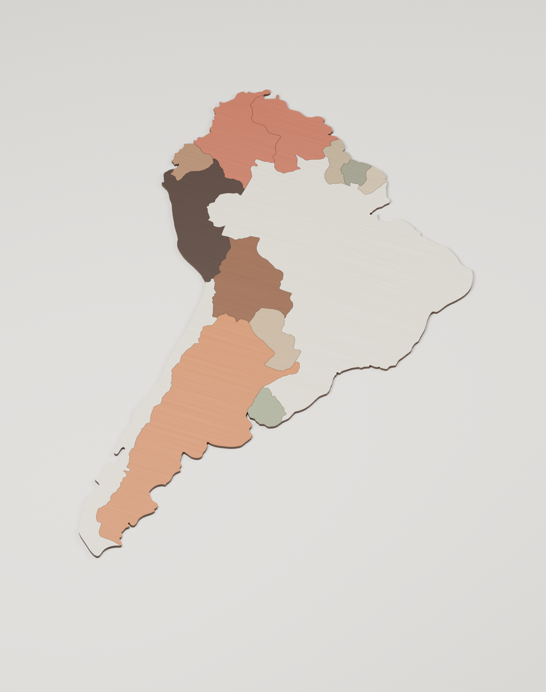

**Бразилия / Южная Америка — политический вариант и совместимый рельеф**

[Скачать два файла Blender, SVG и инструкции](Бразилия-политика-и-рельеф.zip)

Добавлен плоский политический вариант принятого макета Южной Америки: **13 стран и территорий, по одной отдельной детали толщиной 3 мм**. Парный рельеф содержит прежние 78 деревянных деталей и шесть уровней 3 / 6 / 9 / 12 / 15 / 18 мм. Его геометрия и окраска сохранены из последней монолитной версии.

- **Южная-Америка-политическая.blend** — отдельные плоские страны.
- **Южная-Америка-рельеф-по-странам.blend** — прежний рельеф с совместимыми контейнерами стран.
- **SVG-политические/** — замкнутые векторы резки и политических границ каждой страны.
- **Политическая-окраска.svg**, **Политическая-резка.svg**, **Политическая-гравировка.svg** — общие схемы.
- **Страны-и-совмещение.csv** — покрытия, координаты и соответствие объектов.

Держите два файла Blender рядом. Выделите деревянную деталь нужной страны или её контейнер `ЧАСТЬ_…`. В Text Editor откройте встроенный текст `ЗАМЕНИТЬ_ВЫБРАННУЮ_СТРАНУ.py` и нажмите **Run Script**. Выбранная страна заменится плоской или рельефной; остальные останутся на месте. Сохраняются положение, поворот, масштаб контейнера и текущий материал страны. Можно также выполнить обычный Append коллекции `REG_<код>__<название>`.

Центры контейнеров одинаковы в двух вариантах и находятся на нижней плоскости. Плоские Mesh-детали растут вверх при изменении Dimensions Z. Ступени рельефа следуют за толщиной основания, гравировка — за своей поверхностью. Для перемещения целой страны используйте контейнер; изменение толщины отдельного Mesh при замене не переносится, новый вариант получает штатную толщину 3 мм.

Окраска сохранена: Бразилия и Чили — натуральная фанера, Аргентина — рыжая, Боливия — орех, Перу — тёмный акцент, Колумбия и Венесуэла — терракота. Остальные назначения приведены в Палитра.csv. Политическая версия сплошная, без природных ступеней и водных вырезов; новые названия городов не добавлялись.

Проверены замкнутость всех тел, совпадение 13 центров и вершин оснований, изменение толщины 3 / 6 / 9 мм и реальная замена Бразилии, Чили и Боливии в обе стороны с сохранением позы. Отчёты приложены. Исходный монолитный файл не перезаписан.

SVG сохраняют исходную страницу 1600 × 1000 мм, положение и масштаб. Не вписывайте каждый файл отдельно в страницу. Перед резкой задают фактический размер, пропил и раскладку под лист.

Для открытия готовых Blender-файлов дополнительные пакеты не нужны. Скрипты находятся в tools/, замороженный исходник и описание совместимости — в data/. Для генерации нужны Blender 4.3+ с Shapely во встроенном Python и обычный Python с Shapely / lxml. Порядок: `tools/build_pair.py` в Blender, `tools/export_vectors.py` в Python, `tools/verify_pair.py` в Blender. Генератор использует принятые Mesh-основания, рельеф заново не рассчитывает.
