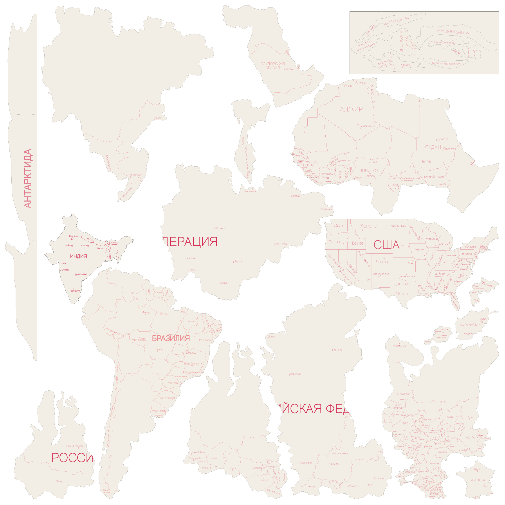
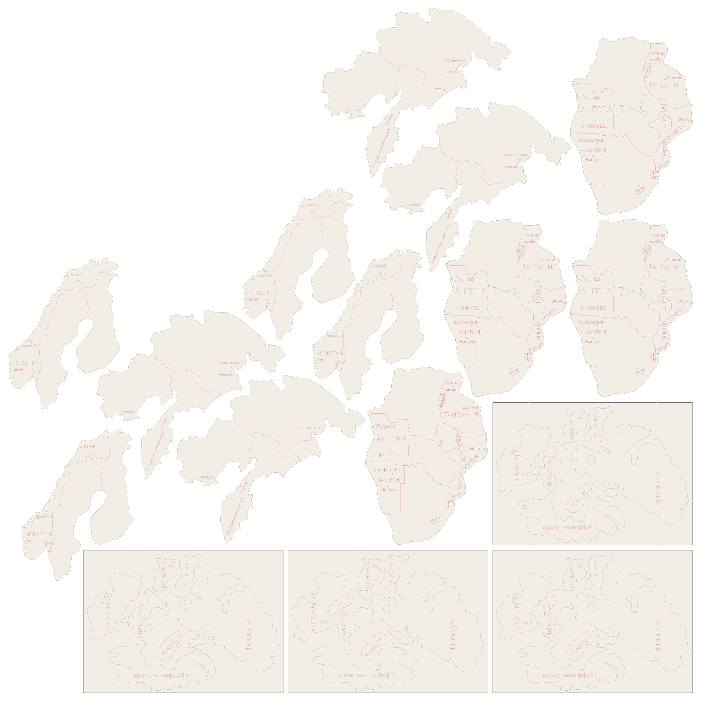

# Белый набор — раскрой с учётом станка

**Поле 740 × 740 мм. Основной лист × 4 + дополнительный × 1 = 4 полных исходных наборов.**

[Скачать готовый комплект](Белый-раскрой-740x740-4-набора.zip) · [Схема и порядок запусков](Порядок-резки.pdf)

| Лист | SVG для CorelDRAW | Векторный PDF 1:1 | Прогонов за цикл |
|---|---|---|---:|
| 01 — основной | [Рабочий SVG](Белый-01-основной-740x740.svg) | [PDF](Белый-01-основной-740x740.pdf) | 4 |
| 02 — остаток × 4 | [Рабочий SVG](Белый-02-дополнительный-на-4-набора-740x740.svg) | [PDF](Белый-02-дополнительный-на-4-набора-740x740.pdf) | 1 |

Можно сначала вырезать дополнительный лист и разложить его содержимое на 4 одинаковых групп. Затем выполнить 4 прогонов основного листа. Получатся ровно 4 полных наборов, без лишних копий отдельных групп. Дополнительный лист на каждом прогоне основного повторять не нужно.

На основном листе **18 групп размещения**. На дополнительном **4 исходные группы повторены по 4 раза** — всего 16 групп. Группа может включать несколько островов или контуров, связанных в исходнике; это не число всех физических островных деталей.

## Размещение с учётом станка

Все три густо подписанные российские части, включая европейскую часть с Москвой, среднюю часть с Уралом и крупную центральную часть с Красноярском, поставлены **у нижнего края**. Большая часть Африки стоит у нижнего края, США — у правого. Детали с мелкой разметкой размещались преимущественно ближе к правой и нижней стороне.

Для раскладки условно защищён **верхний левый квадрат 220 × 220 мм**. Ограничивающие рамки мелких красных элементов туда не заходят. В этой зоне могут находиться большие контуры, крупные надписи и участки деталей без мелкой гравировки. На справочной схеме участок отмечен пунктиром; в рабочих SVG/PDF этой рамки нет.

Проверка мелкой разметки использует красные элементы исходника с наибольшим размером рамки от 0,15 до 6 мм. Проверены полные рамки кривых, а не только центры. Учитывается качественное описание станка из задания; точные физические характеристики луча не измерялись.

Кратность выбрана среди найденных раскладок с этими ограничениями. Абсолютная математическая оптимальность не заявляется. Более плотная прежняя схема с семью повторами заменена текущей схемой ради расположения гравировки.

## Сохранность рисунка

Все **5357 исходных кривых и два текстовых объекта** сохранены в первоначальном виде после импорта CDR. Надписи не перенабирались и шрифты не заменялись. Команды путей, координаты узлов, цвета, стили, толщины линий и исходные разрывы совпадают с импортом. Кривые не сглаживались и не заменялись ломаными. Все элементы только перенесены вместе со своими группами.

**Поворот 0°, отражений нет, масштаб 1:1.** Существующие повороты надписей и островов остались исходными. Каждая страница SVG/PDF — ровно 740 × 740 мм. Минимальный измеренный зазор с учётом всей разметки — **4.35 мм**, отступ от границы поля не менее 5 мм. На рабочих листах нет дополнительных текстов, номеров или рамки резки.

Исходный CDR сохранён без изменений в `data/source/белый.cdr`. Рабочие файлы представлены в SVG и PDF; изменённый CDR не создавался. SVG открывается в CorelDRAW. Проверены записанные SVG и PDF; собственный импорт CorelDRAW здесь не проверялся, поскольку программа не установлена.

## Просмотр

В этих PNG для просмотра добавлена светлая заливка под детали и усилена видимая толщина линий. Рабочие SVG/PDF содержат только исходные элементы с исходными стилями.

## Проверки и генераторы

`Проверка-раскладки.json` подтверждает сохранность каждого исходного элемента, полноту наборов, зазоры и размеры страниц. `Проверка-зоны-станка.json` проверяет размещение ключевых групп и отсутствие мелких кривых в отведённом верхнем левом участке. Все переносы перечислены в `Переносы-деталей.csv`.

`source.svg` — полный импорт исходного CDR через libcdr/librevenge (`tools/import_cdr.cpp`), включая объекты за исходной страницей. Пересборка: extract.py → nest.py → сохранить layout.json как layout-before-machine-quality.json → nest_machine_quality.py → export.py → package.py. Скрипты лежат в tools/, зависимости — requirements.txt; для PDF/PNG нужен Inkscape. Короткие удерживающие разрывы временно замыкаются только в масках упаковки; исходные выходные кривые при этом не меняются.
